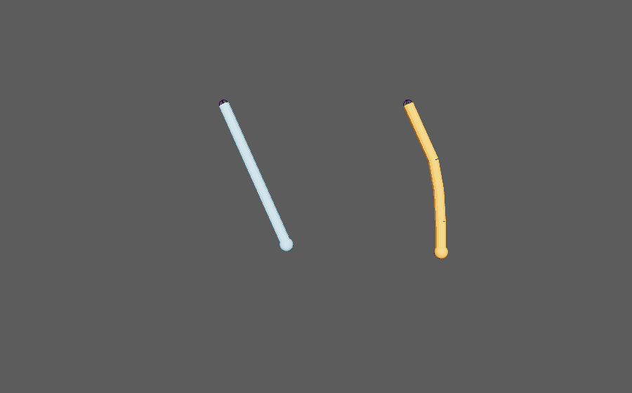
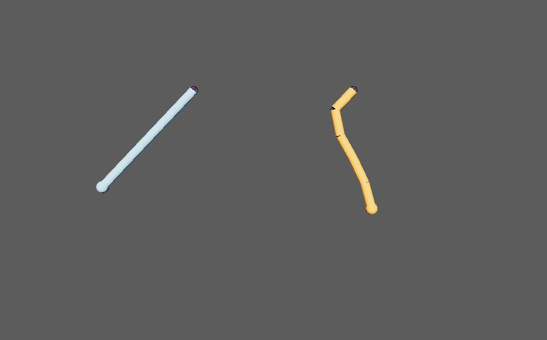

create_pbd_overlap_rotation_bake
================================

選んだジョイント(またはtransform)の並びを1本のチェーンとみなし、根元の動きに遅れて揺れる回転を
子の rotate にキーとしてベイクします。ばねで追いかけて減衰する、物理シミュレーション風の簡単な計算です。

開き方
------

HTools > animation > create_pbd_overlap_rotation_bake。画面はなく、選んで実行するとすぐにベイクします。

使い方
------

1. 根元のジョイントに回転などのアニメーションを付けておきます。
2. 根元から先端へ順に、チェーンのジョイント(transform でもよい)を2つ以上選びます。
   **選んだ順** が根元→先端の順として使われます(joint・transform 以外のノードは無視します)。
3. 再生範囲(タイムスライダーの開始〜終了)を、ベイクしたいフレームに合わせます。
4. HTools > animation > create_pbd_overlap_rotation_bake を実行します。

結果
----

左(水色)はベイクしていないチェーン、右(オレンジ)はベイクしたチェーンです。どちらも根元の rotateZ に
同じキーがあります(見やすいように各ジョイントの子に棒を置いています)。

* 根元(1つ目に選んだもの)のアニメーションはそのままです。
* 2つ目以降は、再生範囲内の rotateX/Y/Z の既存キーを消し、範囲の **毎フレーム** にキーを打ちます。
  タンジェントは auto です。
* 計算の時間の刻みは、シーンのフレームレート(Preferences の Time)から求めます。
* 終わると Script Editor に ``Kawaii-core overlap rotation bake finished: ...`` と、ベイクしたノード数・範囲を出します。

計算の設定
----------

メニューから実行すると、次の値で計算します。値を変えるには、スクリプトから関数を呼びます。

.. list-table::
   :header-rows: 1
   :widths: 20 15 65

   * - 引数
     - メニューの値
     - 意味
   * - ``stiffness``
     - 0.08
     - 元のポーズへ戻す強さ(0〜0.9999)。大きいほど形が崩れにくくなります。
   * - ``damping``
     - 0.92
     - 速度を残す割合(0〜0.9999)。小さいほど早く収まり、1に近いほど揺れが長く残ります。
   * - ``follow``
     - 0.35
     - 目標の位置へ引くばねの強さ。大きいほど早く追いつきます。
   * - ``substeps``
     - 8
     - 1フレームを分けて計算する回数(1以上)。
   * - ``start_frame`` / ``end_frame``
     - 再生範囲
     - ベイクする範囲。省略すると再生範囲の開始・終了。

.. code-block:: python

   from HTools.animation import create_pbd_overlap_rotation_bake as bake

   # 根元から先端へ選んでから実行する
   bake.create_pbd_overlap_rotation_bake(start_frame=1, end_frame=120, stiffness=0.2, damping=0.85)

注意・制限
----------

* **1回の Undo では戻りません**\ (フレームごとのキー操作が別々の Undo になります)。実行前にシーンを保存してください。
* 子の回転キーは、再生範囲内のものを消して置き換えます。範囲外のキーは残ります。
* 選んだものすべてを1本のチェーンとして扱います。複数のチェーンを同時には処理しません。
* 計算するのは位置の遅れだけで、コリジョン・重力などの外力・角度の制限はありません。
  先端の向きは親→先端の方向から決めるので、ねじれ(軸回りの回転)は元のアニメーションのままです。
* 実行中にタイムスライダーの時間を動かすため、終わると現在の時間は範囲の最後になります。
* 選んだものが2つ未満だと ``Select two or more transforms/joints in order from root to tip.`` の警告を出して何もしません。
  終了フレームが開始フレームより前のときも警告を出して止めます。
