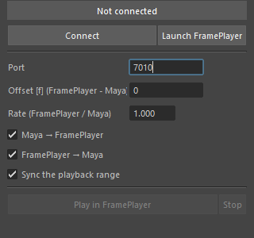

framePlayerSync
===============

コマ送り確認用の動画プレイヤー FramePlayer と、Maya のタイムスライダーを連携させるパネルを開きます。
本体は FramePlayer のパッケージ(``frameplayer``)で、このメニュー項目はその入口です。
連携の詳しい使い方は `FramePlayer のドキュメント <https://hsk0120.github.io/MayaHToolsWorkspace/frameplayer/>`_
(「Maya との連携」のページ)を見てください。

開き方
------

HTools > animation > framePlayerSync。「FramePlayer Sync」のパネルが開きます(すでに開いていれば前に出します)。
スクリプトからは ``import frameplayer; frameplayer.show()`` で開けます。

画面
----

.. list-table::
   :header-rows: 1
   :widths: 30 70

   * - 項目
     - 内容
   * - 状態の表示
     - つながっていないときは ``Not connected``、つながると ``Connected (port 番号)`` と緑で表示します。
       FramePlayer で再生中は ``FramePlayer is playing`` を付け加えます。
   * - Connect / Disconnect
     - 起動している FramePlayer へ接続します。つながっている間は Disconnect になり、押すと切ります。
   * - Launch FramePlayer
     - FramePlayer を連携モードで起動し、つながるまで自動で接続を試します。
   * - Port
     - 接続するポート番号(既定 7010)。
   * - Offset [f] (FramePlayer - Maya)
     - フレーム番号のずれ。FramePlayer の番号 = Maya の番号 × Rate + Offset です。
   * - Rate (FramePlayer / Maya)
     - フレーム番号の倍率(0.001 以上)。
   * - Maya → FramePlayer
     - Maya の時間を動かすと、FramePlayer が同じフレームを表示します。
   * - FramePlayer → Maya
     - FramePlayer でコマ送り・再生すると、Maya の時間が追従します。
   * - Sync the playback range
     - 再生範囲も合わせます。
   * - Play in FramePlayer / Stop
     - FramePlayer で再生を始める・止める(つながっている間だけ押せます)。

設定の値は保存され、次に開いたときも同じ値になります。つながっている間に変えた設定は、すぐに反映されます。

使い方
------

1. Launch FramePlayer を押します。FramePlayer が連携モードで起動し、自動でつながります。
2. FramePlayer をすでに開いている場合は、FramePlayer の「Maya Sync」ボタンを押してから、このパネルの Connect を押します。
3. つながると、Maya のタイムスライダーと FramePlayer のフレームが連動します。

注意
----

* このパネルには Help メニューがありません(FramePlayer は HTools から独立したパッケージのため)。
  このページは HTools メニューの Help から開けます。
* FramePlayer 本体(exe)の入手・インストール・色の扱いなどは、FramePlayer のドキュメントを見てください。
