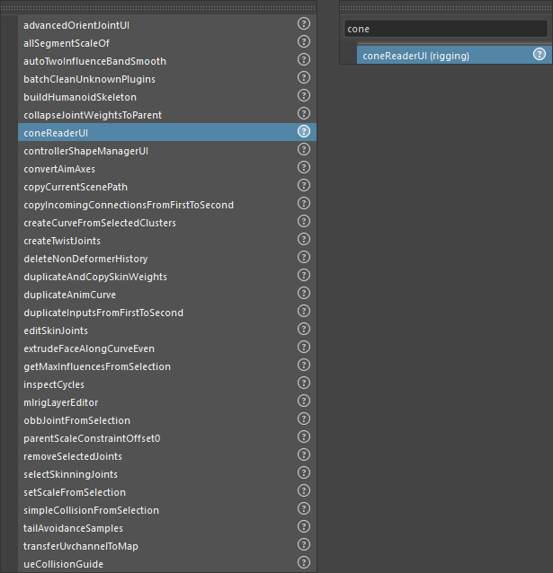

HTools ドキュメント
====================

HToolsは、Mayaのメニューバーの「HTools」から使う内製ツール集です。
このページでは、ツールごとに使い方と画面(メニュー・ボタン)を説明します。

.. toctree::
   :maxdepth: 2
   :caption: カテゴリ

   animation/index
   material/index
   rigging/index
   system/index

HToolsメニューの使い方
----------------------

- メニューの先頭の検索欄に文字を入れると、全カテゴリのツールを名前で絞り込めます。
- カテゴリ(フォルダー)の中の項目を選ぶと、そのツールがすぐに実行されます。
  画面のあるツールは画面が開き、画面の無いツールは選択中のものに対して処理します。
- 各ツール名の右端の **?** を押すと、そのツールのページが開きます(ツールは実行されません)。
  検索結果の項目にも **?** が付きます。画面のあるツールは、画面の Help からも自分のページを開けます。
- メニューの一番下の **Help > HTools Documentation** から、このドキュメントの目次を開けます。

ツールの追加
------------

``HTools/<カテゴリ>/`` に ``.py`` を1つ置くと、次の起動からメニューに出ます。
説明ページは ``HTools/_docs/<カテゴリ>/<ツール名>.rst`` に書き、カテゴリの目次へ並べます。
