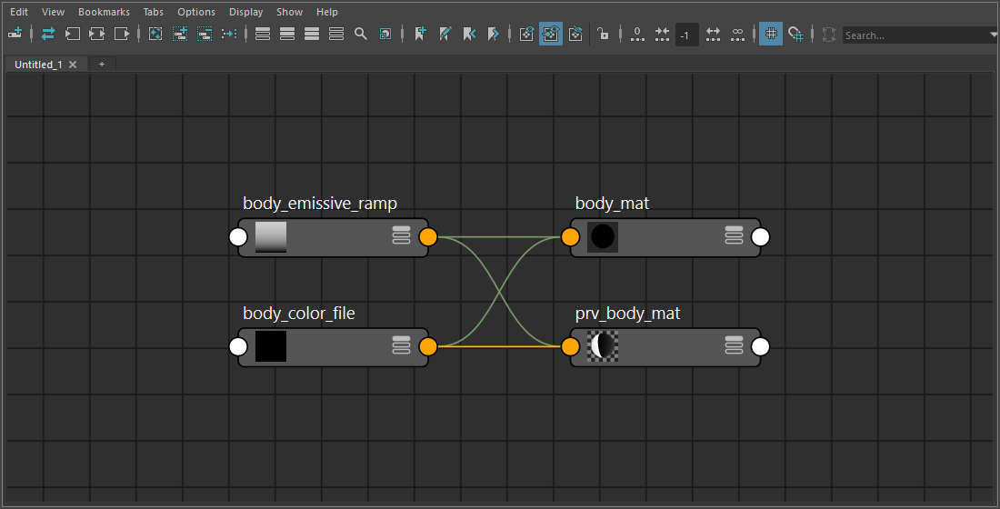

create_preview_sharder
======================

選んだシェーダーから、ビューポートでの確認用の blinn(``prv_<元の名前>``)を作り、
カラーと発光のテクスチャの接続を移します。

開き方
------

HTools > material > create_preview_sharder。画面はなく、選んで実行するとすぐに作ります。

使い方
------

1. 元にするシェーダーのノードを1つ選びます(Hypershade・Outliner など。複数選んだときは最初の1つ)。
2. HTools > material > create_preview_sharder を実行します。

結果
----

元のシェーダー ``body_mat`` の color に ``body_color_file``、emissive に ``body_emissive_ramp`` がつながっている例です。
新しい ``prv_body_mat`` にも同じテクスチャがつながります。

* ``prv_<元の名前>`` という名前の blinn を作り、eccentricity を 0 にします。
* 元のシェーダーの入力を、次の対応で blinn へつなぎます(元の接続はそのまま残ります)。

  .. list-table::
     :header-rows: 1
     :widths: 40 60

     * - 元のシェーダー
       - prv\_ の blinn
     * - ``color`` の入力
       - ``color``
     * - ``emissive`` の入力
       - ``incandescence``
     * - ``color`` につながったノードの ``outTransparency``
       - ``transparency``

* 終わると Script Editor に ``Created: prv_... / connections transferred: 件数`` を出します。
* 作成と接続は1回の Undo で戻せます。

注意・制限
----------

* **元のシェーダーに** ``emissive`` **アトリビュートが必要です。** Maya 標準のシェーダー(lambert・blinn・
  standardSurface など)には ``emissive`` が無いため、``No object matches name: ....emissive`` のエラーで止まります。
  このとき ``prv_`` の blinn は作られたまま残るので、Undo で消してください。
  (上の画像は、撮影用に lambert へ ``emissive`` を足して撮っています。)
* color や emissive に入力が無ければ、その項目はつなぎません。color に入力が無いときは、
  transparency もつながない旨の警告を出します。入力が複数あるときは最初の1つだけを使います。
* ``prv_<元の名前>`` がすでにあると、``A node with the same name already exists`` のエラーで止まります。
* 何も選んでいないと ``Select one shader.``、シェーダー以外を選ぶと ``The selected node is not a shader.`` のエラーになります。
* 接続先がロックされている、または同じ接続がすでにあるときはエラーになります。
* シェーディンググループは作りません。メッシュへの割り当ては手で行ってください。
