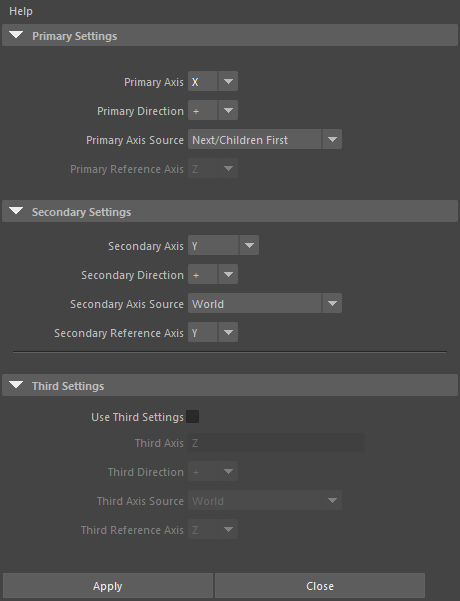
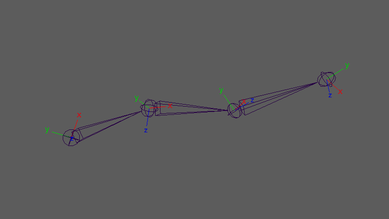
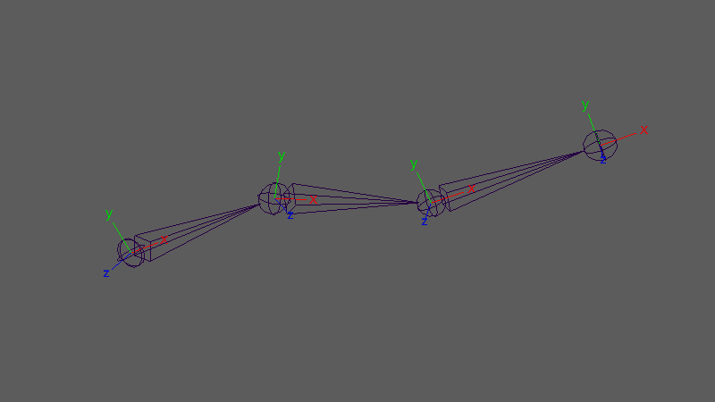

advancedOrientJointUI
=====================

Maya 標準の Orient Joint を拡張した、ジョイントの向き(jointOrient)をそろえるツールです。
主軸・副軸がどの方向を向くかを、ワールド軸・今のローカル軸・子ジョイントの方向から選べます。
スキンの付いたジョイントでも、メッシュの形を崩さずに向きを変えます。

開き方
------

HTools > rigging > advancedOrientJointUI。「Orient Joint Options (Custom)」の画面が開きます。

画面
----

Axis Source(方向の元)は3つの欄で共通で、次の4つから選びます。

.. list-table::
   :header-rows: 1
   :widths: 30 70

   * - Axis Source
     - 方向の決め方
   * - World
     - ワールドの軸(Reference Axis で X/Y/Z を選ぶ)。
   * - Local
     - ジョイントの **今の** ローカル軸(Reference Axis で X/Y/Z を選ぶ)をワールドで見た方向。
   * - Next/Children First
     - 1本目の子ジョイントへの方向(子の順はアウトライナーの並び順)。子が無い末端のジョイントは、親から自分への方向を使います。
   * - Next/Children Second
     - 2本目の子ジョイントへの方向。2本目の子が無いジョイントは処理しません(警告を出して飛ばします)。

Reference Axis は、Axis Source が World か Local のときだけ選べます。

.. list-table::
   :header-rows: 1
   :widths: 30 70

   * - 項目
     - 内容
   * - Help メニュー
     - Advanced Orient Joint Help でこのページを開きます。
   * - Primary Axis
     - 主軸にするジョイントの軸(X/Y/Z。既定 X)。
   * - Primary Direction
     - ``+`` はその軸の正の向き、``-`` は逆向きを、下の方向へ向けます。
   * - Primary Axis Source / Primary Reference Axis
     - 主軸を向ける方向(既定は Next/Children First = 子ジョイントの方向)。
   * - Secondary Axis
     - 副軸にするジョイントの軸(X/Y/Z。既定 Y)。Primary Axis と違う軸を選びます。
   * - Secondary Direction
     - ``+`` / ``-``。副軸の向きを反転します。
   * - Secondary Axis Source / Secondary Reference Axis
     - 副軸を向ける目安の方向(既定は World の Y)。主軸と直交するように補正して使います。
   * - Use Third Settings
     - オンにすると、残りの1軸(Third Axis)の向きで符号をそろえます(既定はオフ)。
   * - Third Axis
     - 残りの軸の表示(Primary・Secondary で使っていない軸)。編集はできません。
   * - Third Direction / Third Axis Source / Third Reference Axis
     - 残りの軸を向けたい側。残りの軸がこの方向と逆を向くときは、副軸と残りの軸を反転して、指定した側へそろえます(主軸は変えません)。
       方向が主軸・副軸の平面上にあり向きを決められないときは反転しません。
   * - Apply
     - 選んでいるジョイントに適用します。
   * - Close
     - 画面を閉じます。

使い方
------

1. 向きを変えたいジョイントを選びます(選んだジョイントだけが対象で、子は自動では含みません。チェーン全体なら全部選びます)。
2. 主軸・副軸の設定を選び、Apply を押します。
3. ビューに ``Orient Joint applied.`` と出ます。

上が適用前、下が既定の設定(主軸 X を子の方向、副軸 Y をワールドの Y 側)で4つのジョイントに適用した後です。
末端のジョイントは、親から自分への方向に X を向けます。

結果
----

* 求めた向きを jointOrient に書き込み、rotate を 0 にします(回転は jointOrient にまとまります)。
* 親から先に処理します(選んだ順には依存しません)。
* 向きを変えたジョイントの子孫は、ワールドでの位置・向きを保ちます。選んでいない子孫は、translate・rotate を書き換えて元の姿勢を保ちます。
* 親空間は、ジョイント以外の親(グループなど)・rotateAxis・segmentScaleCompensate も含めて計算します。
* 影響するスキンクラスターは、ジョイントを動かしてもメッシュの形が変わらないように保護します(ジョイントを動かすモードで処理し、バインド行列を取り直す)。
* 1回の適用は1回の Undo で戻せます。

注意・制限
----------

* Secondary Axis の ``None`` は使えません。選ぶと ``Primary/Secondary axis must be different and one of x/y/z.`` の警告が出て何もしません。
  Primary Axis と同じ軸を選んだときも同じです。
* 何も選んでいないと ``Select joint(s) first.`` の警告を出します。
* 方向が決まらないジョイント(子も親も無く、Next/Children を使う設定など)は ``Skip ...: could not resolve orient direction.`` の警告を出して飛ばします。
* 副軸の目安の方向が主軸とほぼ平行なときは、代わりの方向(ワールド Y、それも平行ならワールド X との外積)で副軸を決めます。
* 親空間に、segmentScaleCompensate で打ち消されない不均一なスケールがあると、軸がゆがむため回転成分で近似します。
