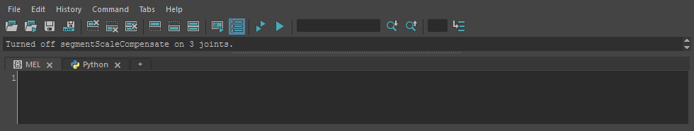

allSegmentScaleOf
=================

シーンにあるすべてのジョイントの ``segmentScaleCompensate`` をオフ(0)にします。
ゲームエンジンへ書き出すときなど、親のスケールを子へそのまま伝えたいときに使います。

開き方
------

HTools > rigging > allSegmentScaleOf。画面はなく、実行するとすぐに処理します。

使い方
------

HTools > rigging > allSegmentScaleOf を実行します。選択は使いません(シーンの全ジョイントが対象です)。

結果
----

Script Editor に ``Turned off segmentScaleCompensate on <数> joints.`` と出します。
数はシーンのジョイントの総数です(すでにオフだったものも含みます)。

注意・制限
----------

* リファレンスのジョイントも含め、シーンのすべてのジョイントが対象です。選んだものだけを変えることはできません。
* オンに戻す機能はありません。戻すときは Undo します(ジョイントごとに1回ずつの Undo になります)。
* ロックされている・接続されているなどで値を変えられないジョイントがあると、そこでエラーになり止まります。
* 親をスケールしているリグでは、オフにすると子の見た目の大きさが変わります。
