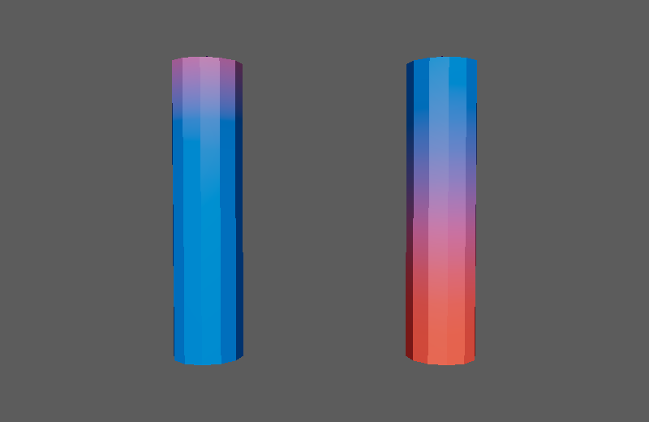
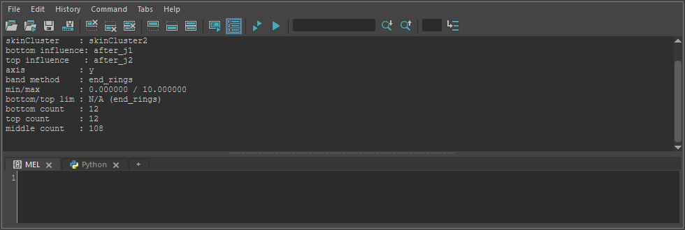

autoTwoInfluenceBandSmooth
==========================

筒状のメッシュ(髪の房・紐・指など)のスキンウェイトを、両端の2つのインフルエンスで作り直します。
両端の頂点をそれぞれ1つのインフルエンスに固定し、その間の頂点のウェイトを平滑化してなめらかにつなぎます。

開き方
------

HTools > rigging > autoTwoInfluenceBandSmooth。画面はなく、選んで実行するとすぐに処理します。

使い方
------

1. skinCluster の付いたメッシュを選びます(transform・シェイプ・コンポーネントのどれでもよい。複数選べます)。
   skinCluster には、両端に近いインフルエンス(ジョイント)が2つ以上必要です。
2. HTools > rigging > autoTwoInfluenceBandSmooth を実行します。

処理の流れ
----------

メッシュごとに次のことを行います。基準の軸は Y(下=Y が小さい側、上=Y が大きい側)です。

1. **両端の頂点を決める。** 次の順に試し、うまくいかなければ次の方法にします。

   .. list-table::
      :header-rows: 1
      :widths: 30 70

      * - 方法(Script Editor の ``band method``)
        - 内容
      * - ``end_rings``
        - 開いた縁(境界エッジ)の輪を探し、Y が一番小さい輪を下端、一番大きい輪を上端にします。
          縁が1つだけのとき(先が閉じた形)は、反対側を Y の端の頂点にします。
      * - ``axis_apex``
        - ``end_rings`` の上下の頂点数が大きく偏るとき。縁が1つで、Y が最大の頂点が1つだけ(上が尖った円錐のような形)なら、
          その頂点を上端、縁を下端にします。
      * - ``axis_equal_count``
        - それも合わないとき。頂点を Y の順に並べ、頂点数で下・中・上の3つに分けます。
      * - ``geodesic``
        - 頂点が5つだけのメッシュ。メッシュ上で最も離れた2頂点を両端とし、そこからの距離の割合で頂点を下・中・上に分けます。
      * - ``world_band_fallback``
        - 上の方法が使えないとき。Y の最小から 9.0 以内を下端、最大から 3.0 以内を上端にします(ワールドの距離)。

2. **インフルエンスを決める。** 下端・上端の頂点の中心に一番近いジョイントを、それぞれのインフルエンスにします
   (``world_band_fallback`` のときは、Y が一番小さい/大きいジョイント)。
3. 両端の頂点のウェイトを2つのインフルエンスに固定します。
4. 中間の頂点を選び、skinCluster の Smooth Weights(許容値 0.0、最大反復 5)を2回かけ、ウェイトを正規化します。
5. 両端をもう一度固定します。

結果
----

ウェイトを頂点カラーで表した図です(青=下のジョイント、赤=上のジョイント)。左が処理前(スムースバインドのまま)、右が処理後です。
右は両端が1つのインフルエンスに固定され、間がなめらかにつながっています。
**ただし、下の注意のとおり、両端のインフルエンスが入れ替わっています。**

* Script Editor に、メッシュごとの skinCluster・選んだインフルエンス・端の決め方・下端/上端/中間の頂点数を出します。
* 終わると中間の頂点が選ばれた状態になります(中間の頂点が無いときは元の選択に戻します)。
* 全メッシュの処理を1回の Undo で戻せます。

注意・制限
----------

* **現在のコードでは、両端のインフルエンスが逆に固定されます。** 下端の頂点が上のインフルエンス(``top influence``)に、
  上端の頂点が下のインフルエンス(``bottom influence``)に 100% になります(上の画像の右の円柱)。
  意図した結果にならないときは、Undo で戻してください。
* 基準の軸(Y)・端の範囲(9.0 / 3.0)・平滑化の回数は、メニューからは変えられません。変えるときはスクリプトから
  ``auto_two_influence_band_smooth(axis=..., bottom_range=..., top_range=..., smooth_passes=...)`` を呼びます。
  インフルエンスを ``bottom_influence`` ・ ``top_influence`` で指定することもできます。
* 両端以外のインフルエンスのウェイトは、固定した頂点では 0 になり、中間の頂点では平滑化に任せます。
* 端の決め方が失敗して別の方法に切り替えたときは、警告(``... Fallback to world band.``)を出します。
* 中間の頂点が無いときは平滑化を飛ばし、警告を出します。
* メッシュが選ばれていない、skinCluster が無い、インフルエンスが足りない、端の頂点が見つからないときはエラーで止まります。
