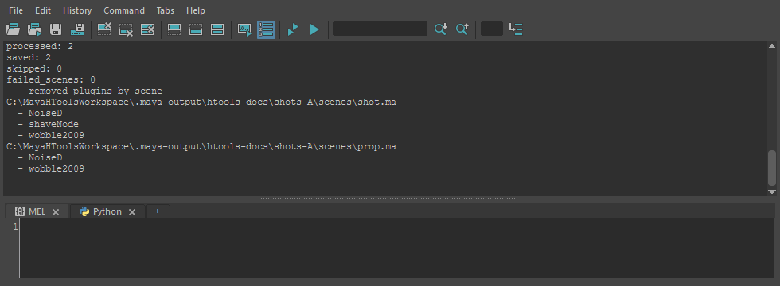

batchCleanUnknownPlugins
========================

今のシーンと、そこから参照しているシーン(リファレンス)を順にたどって開き、決まった古いプラグインの
unknownPlugin(シーンに残った、見つからないプラグインの記録)を取り除いて **上書き保存** します。

開き方
------

HTools > rigging > batchCleanUnknownPlugins。画面はなく、実行するとすぐに処理を始めます。

取り除くプラグイン
------------------

メニューから実行すると、次の名前の unknownPlugin だけを取り除きます(大文字小文字は区別しません)。

``wobble2009`` ・ ``DF_locator_09win32`` ・ ``NoiseD`` ・ ``shaveNode`` ・ ``wmSolid`` ・ ``wobble2013-x64``

使い方
------

1. 処理を始めるシーンを開き、保存しておきます(保存していないシーンからは始められません)。
2. HTools > rigging > batchCleanUnknownPlugins を実行します。
3. 終わると、始めたシーンが開き直されます。Script Editor の報告を確かめます。

処理の流れ
----------

1. 今のシーンのファイルを開き直し、対象の unknownPlugin を取り除きます。
2. 1つでも取り除いたら、そのシーンを上書き保存します。
3. そのシーンのリファレンスのファイルを順番待ちに加え、まだ開いていないものを同じように開いて処理します(リファレンスのリファレンスもたどります)。
4. 最後に、始めたシーンを開き直します。

結果
----

Script Editor に ``=== batch_clean_unknown_plugins report ===`` に続けて、処理したシーン数(processed)・保存した数(saved)・
見つからず飛ばした数(skipped)・開けなかった数(failed_scenes)と、シーンごとに取り除いたプラグイン名を出します。
取り除けなかったもの・開けなかったシーンがあれば、その理由も出します。

注意・制限
----------

* **シーンのファイルを上書き保存します。** 元に戻す Undo はありません。必要なら先にバックアップを取ってください。
  リファレンスのファイル(共有のアセットなど)も上書きされます。
* **今開いているシーンの未保存の変更は、確認なしに捨てられます**\ (開き直すため)。実行前に保存してください。
* シーンを保存していない(名前の無い)ときは ``root_scene_path is not specified and the current scene has not been saved.`` のエラーで止まります。
* 見つからないリファレンスのファイルは飛ばします(skipped)。開けなかったシーンは failed_scenes に出し、処理を続けます。
* unknown 型のノード(見つからないプラグインのノード)は消しません。取り除くプラグインの名前を変えたり、すべての
  unknownPlugin や unknown ノードを消したりするときは、スクリプトから呼びます。

  .. code-block:: python

     from HTools.rigging import batchCleanUnknownPlugins as clean

     clean.batch_clean_unknown_plugins(
         remove_all_unknown=True,     # 名前によらず全 unknownPlugin を取り除く
         remove_unknown_nodes=True,   # unknown 型のノードも消す
         save_scene=False,            # 保存しない(確認用)
     )

* 開くときにファイルのバージョン違いは無視します。プラグインが見つからない旨のエラーが Script Editor に出ることがありますが、処理は続きます。
