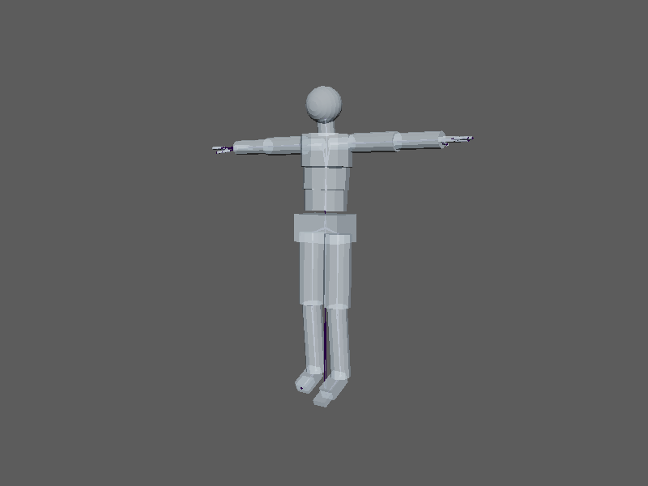

buildHumanoidSkeleton
=====================

一般的な人間の全身骨格(Tポーズ、身長約170cm)と、骨ごとの簡易プロキシメッシュをシーンに作ります。
リグや検証を人型で試すときの土台に使います。本体は ``mlrig.examples.humanoid.build`` で、骨格の詳しい説明は
`mlrig のドキュメント(全身骨格のサンプル) <https://hsk0120.github.io/MayaHToolsWorkspace/mlrig/humanoid_example.html>`_ にあります。

開き方
------

HTools > rigging > buildHumanoidSkeleton。画面はなく、実行するとすぐに作ります。

結果
----

* 関節名は UE のマネキン / MetaHuman 風(``root`` ・ ``pelvis`` ・ ``spine_01`` 〜 ``spine_03`` ・ ``neck_01`` ・ ``head`` 、
  左右の ``clavicle`` ・ ``upperarm`` ・ ``lowerarm`` ・ ``hand`` ・指・ ``thigh`` ・ ``calf`` ・ ``foot`` ・ ``ball``。左右は ``_l`` ・ ``_r``)です。
* Y が上、+Z が正面、キャラクターの左が +X です。単位は cm。
* プロキシメッシュは関節の子に置かれるので、関節と一緒に動きます(スキンではありません)。
* 作り終わるとルート関節が選ばれ、Script Editor に ``Built a humanoid skeleton: <関節数> joints, <メッシュ数> proxy meshes, root '<ルート>'.`` と出ます。
* 作成は1回の Undo で戻せます。

注意
----

* 同じ名前の関節がすでにあるときは、``human2_`` ・ ``human3_`` … の接頭辞を付けて、もう1体作ります。
* 指を省く・Aポーズで作る・プロキシを作らないなどは、メニューからは選べません。スクリプトから
  ``mlrig.examples.humanoid.build(fingers=False, pose="A", proxy=False)`` のように呼びます。
* mlrig が読み込めない環境では動きません。
