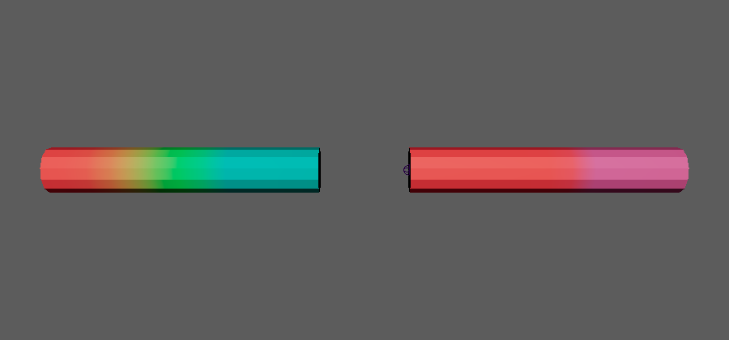

collapseJointWeightsToParent
============================

選んだジョイントのスキンウェイトを親ジョイントへ足し込み、選んだジョイントを削除します。
LOD(軽量版のリグ)を作るときに、骨の数を減らす用途を想定しています。

開き方
------

HTools > rigging > collapseJointWeightsToParent。画面はなく、選んで実行するとすぐに処理します。

使い方
------

1. 減らしたいジョイントを選びます(複数可)。
2. HTools > rigging > collapseJointWeightsToParent を実行します。

結果
----

ウェイトを頂点カラーで表した図です(赤=根元、緑=真ん中、青=先端のジョイント)。左が処理前、右が真ん中のジョイントを選んで実行した後です。
真ん中のウェイト(緑)が親(赤)に移り、真ん中のジョイントは無くなっています。

選んだジョイントごとに、次のことを行います。

1. そのジョイントをインフルエンスに持つ skinCluster をすべて探します。
2. 親ジョイントがその skinCluster に無ければ、ウェイト 0 でインフルエンスに加えます。
3. 各頂点で、選んだジョイントのウェイトを親のウェイトに足し、選んだジョイントのウェイトを 0 にします。
4. 選んだジョイントを skinCluster のインフルエンスから外します。
5. 選んだジョイントの子ジョイントを、親ジョイントの子に付け替えます(ワールドの位置は保ちます)。
6. 選んだジョイントを削除します。

* 階層の深いもの(子の側)から処理するので、親子を一緒に選んでもかまいません。
* ロックされたウェイト(Lock Weights)は、処理の間だけ外して元に戻します。
* 全部の処理を1回の Undo で戻せます。

注意・制限
----------

* 親が **ジョイント** でないもの(ルートのジョイントや、親がグループのもの)は ``Skipped because the parent joint was not found`` の警告を出して飛ばします。
* スキンに使われていないジョイントは、警告(``skinCluster not found ...``)を出したうえで、子を付け替えて削除します。
* ポリゴンメッシュの頂点だけを処理します。NURBS などのウェイトは移りません(インフルエンスから外すときにエラーになることがあります)。
* ウェイトは頂点ごとに正規化しながら書き込むので、ほかのインフルエンスのウェイトがわずかに変わることがあります。
* 選んだジョイントの直下にある、ジョイント以外の子(コンストレイント・メッシュ・ロケーターなど)は付け替えず、選んだジョイントと一緒に削除されます。
* 何も選んでいないと ``Select joints.`` の警告を出します。
