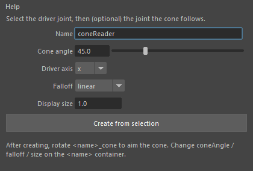
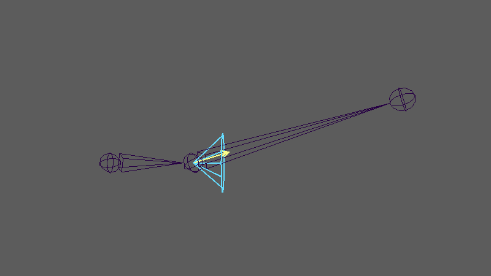

coneReaderUI
============

ジョイントの向きが、決めた方向(コーンの軸)にどれだけ近いかを 0〜1 で出すセットアップを作る画面です。
コーンの中心と一致すると 1、なす角がコーンの半角に達すると 0 になります。補正シェイプやドリブンキーの入力に使います。
計算は ``mlrig.setups.ConeReader`` が標準ノードで行います。詳しくは
`mlrig のドキュメント(コーンの一致度) <https://hsk0120.github.io/MayaHToolsWorkspace/mlrig/cone_reader.html>`_ を見てください。

開き方
------

HTools > rigging > coneReaderUI。「Cone Reader」の画面が開きます。

画面
----

.. list-table::
   :header-rows: 1
   :widths: 25 75

   * - 項目
     - 内容
   * - Help メニュー
     - Cone Reader Help でこのページを開きます。
   * - Name
     - 作るセットアップの名前(既定 ``coneReader``)。container と各 transform の名前の頭に付きます。空なら ``coneReader``。
   * - Cone angle
     - コーンの半角(1〜180 度。既定 45)。
   * - Driver axis
     - 1つ目に選んだジョイントのどの軸を矢印(ドライバー)にするか(x/y/z/-x/-y/-z。既定 x)。
   * - Falloff
     - 中心から縁への減り方。``linear``\ (直線)か ``smooth``\ (なめらか)。
   * - Display size
     - 矢印とコーンの表示の長さ(既定 1.0)。
   * - Create from selection
     - 選択からセットアップを作ります(下の「使い方」)。

Cone angle・Falloff・Display size は、作った後でも container のアトリビュートで変えられます。

使い方
------

1. ドライバーのジョイント(向きを調べたいジョイント)を選びます。
2. 必要なら、Ctrl を押しながらコーンを追従させるジョイント(多くは親)を2つ目に選びます。
3. 欄を設定して Create from selection を押します。
4. ``<名前>_cone`` が選ばれた状態になります。回転させて、weight を 1 にしたい向きへコーンを向けます。

上腕(``upperArm``)をドライバー、親の ``clavicle`` をコーンの追従先にして作り、上腕を回した状態です。
黄色が矢印(ドライバー)、水色がコーンです。

作られるもの
------------

* ``<名前>_driver_GRP`` → ``<名前>_driver``: 矢印(黄色)。1つ目のジョイントにコンストレイントします。
* ``<名前>_cone_GRP`` → ``<名前>_cone``: コーン(水色)。2つ目のジョイントにコンストレイントします。
  2つ目を選ばなければ、コーンはどこにも追従しません。
* ``<名前>``\ (container): 出力 ``weight``\ (0〜1)と、入力の coneAngle・falloff・size などを持ちます。

作った後、Script Editor に ``Created <名前>: rotate '<名前>_cone' to aim the cone. ...`` と出ます。
作成直後はコーンの軸が矢印の向きと同じなので、weight は 1 から始まります。

注意・制限
----------

* 何も選ばずに押すと ``Select the driver joint first, then optionally the joint the cone follows.`` の警告を出します。
  選択は transform(ジョイントを含む)だけを数え、3つ目以降は使いません。
* 同じ名前(``<名前>`` ・ ``<名前>_driver_GRP`` ・ ``<名前>_cone_GRP``)がすでにあると、``Name already exists`` のエラーで止まります。2つ目からは Name を変えてください。
* 向きだけで比べ、位置や距離は使いません。
