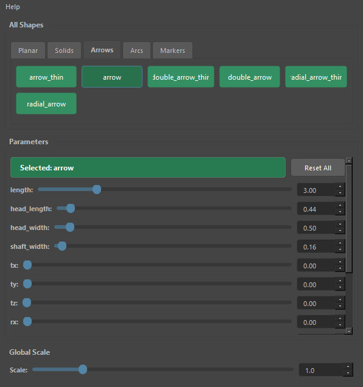
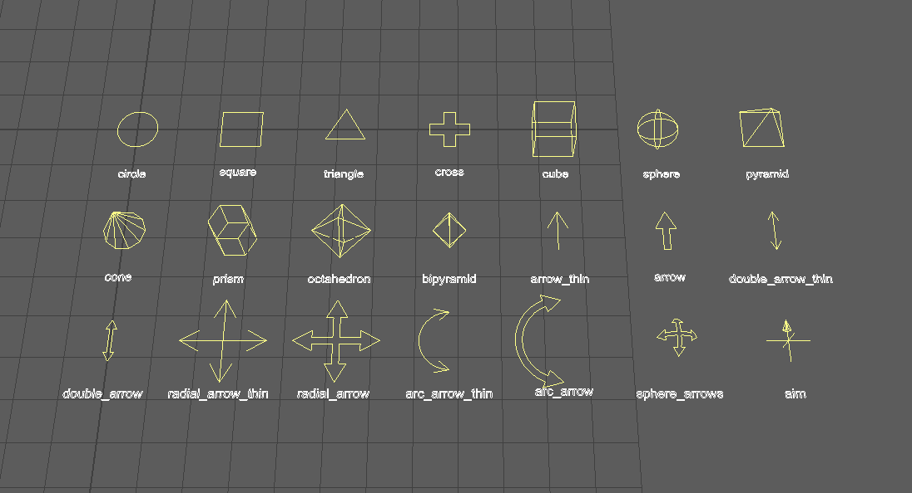

controllerShapeManagerUI
========================

コントローラー用のカーブ形状(円・立方体・矢印など21種類)を、ボタンを押して作るツールです。
選択中のカーブの形状を、transform を残したまま差し替えることもできます。

開き方
------

HTools > rigging > controllerShapeManagerUI。「Controller Shape Manager」の画面が開きます(ドッキングできます)。

画面
----

.. list-table::
   :header-rows: 1
   :widths: 25 75

   * - 項目
     - 内容
   * - Help メニュー
     - Controller Shape Manager Help でこのページを開きます。
   * - All Shapes
     - 形状のボタンを種類ごとのタブ(Planar・Solids・Arrows・Arcs・Markers)に並べます。
       ボタンにマウスを重ねると形状の説明が出ます。ボタンを押すと、すぐにその形状を作ります(下の「使い方」)。
   * - Parameters
     - 選んだ形状の寸法を、スライダーと数値欄で変えます。\ ``Selected:`` に選んだ形状の名前を表示します。
       寸法の項目の後ろに、全形状共通の ``tx`` ``ty`` ``tz``\ (移動)・\ ``rx`` ``ry`` ``rz``\ (回転、度、X→Y→Z の順)・
       ``sx`` ``sy`` ``sz``\ (スケール)が並びます。これらは transform ではなく CV の位置に加えます。
   * - Reset All
     - Parameters の値をすべて既定値へ戻します。
   * - Global Scale
     - 0.1〜5.0 の倍率。小数の値の項目(寸法・移動・回転・スケール)すべてに掛けます。
       本数・角数などの整数の項目には掛けません。

形状の一覧
~~~~~~~~~~

.. list-table::
   :header-rows: 1
   :widths: 15 25 60

   * - タブ
     - 形状
     - 内容
   * - Planar
     - circle・square・triangle・cross
     - XZ 平面に置く平面図形。circle だけは Maya の circle コマンドで作る次数3のカーブ(ほかは次数1の折れ線)
   * - Solids
     - cube・sphere・pyramid・cone・prism・octahedron・bipyramid
     - 立体のワイヤーフレーム。cone・prism・bipyramid は角数(``sides``)を変えられます
   * - Arrows
     - arrow_thin・arrow・double_arrow_thin・double_arrow・radial_arrow_thin・radial_arrow
     - XZ 平面の矢印。1方向の矢印は -Z を指します。\ ``_thin`` は線で、付かないものは輪郭で描きます。
       radial は本数(``arms``)を変えられます
   * - Arcs
     - arc_arrow_thin・arc_arrow
     - 両端に矢じりのある円弧(回転の向きを示す)。角度(``sweep``\ 、度)を変えられます
   * - Markers
     - sphere_arrows・aim
     - 球に沿って曲がる放射状の矢印と、3軸の線と -Z 側の矢じりでエイムの向きを示す目印

使い方
------

新しく作る
   1. 何も選ばずに(またはカーブの無いものを選んで)、形状のボタンを押します。
   2. 原点に ``ctrlCurve`` という名前のカーブができ、選択されます。
   3. 選択したまま Parameters・Global Scale を変えると、そのカーブの形状がすぐに作り直されます。

選択中のカーブの形状を差し替える
   1. 形状を変えたいコントローラー(nurbsCurve のシェイプを持つ transform、またはそのシェイプ)を選びます。
   2. 形状のボタンを押すか、Parameters を変えます。
   3. transform(名前・位置・接続・アトリビュート)はそのままで、nurbsCurve のシェイプだけが新しい形状に置き換わります。
      transform の下にある nurbsCurve 以外のシェイプは残ります。

注意・制限
----------

- 自動の作り直しは、何かを選択しているときだけ行います。何も選んでいないときに Parameters を変えても何も起きません。
- 選択が複数あるときは、最初の1つだけを対象にします。
- circle は差し替えに対応していません。circle を選んで Parameters を変えると、変えるたびに新しい円ができます。
- ジョイントなど transform 以外のノードや、nurbsCurve のシェイプを持たない transform を選んでいる場合は、差し替えずに新しいカーブを作ります。
- 数値欄の範囲は既定値から決めています。移動・回転は 0 以上、スケールは 1 以上しか入れられません。
- Global Scale は回転(``rx`` など)とスケール(``sx`` など)にも掛かります。
- circle 以外の形状の作成・差し替えは、1回ごとに Undo で戻せます。スライダーを動かすと、動かした分だけ作り直しが Undo の履歴に残ります。
