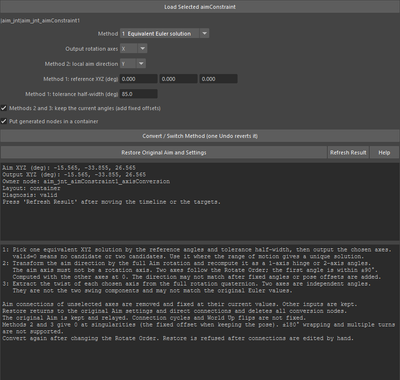

convertAimAxes
==============

既存の aimConstraint の回転出力を、1軸または2軸(X・Y・Z・XY・XZ・YZ)の回転へ変換するツールです。
元の aimConstraint は計算元として残し、その後ろに Maya 標準のノードを挟みます。
3つの方式を切り替えて結果を比べ、いつでも元の接続へ戻せます。

計算の詳細・Python からの使い方は mlrig のドキュメント
`Aimの1〜2軸変換 <https://hsk0120.github.io/MayaHToolsWorkspace/mlrig/aim_axis_conversion.html>`_ にあります。

開き方
------

aimConstraint ノードを1つ選んでから、HTools > rigging > convertAimAxes。
「Compare 1-2 Axis Aim Conversions」の画面が開き、選択中の aimConstraint を読み込みます。

画面
----

.. list-table::
   :header-rows: 1
   :widths: 35 65

   * - 項目
     - 内容
   * - Load Selected aimConstraint
     - 選択中の aimConstraint を1つ読み込みます。その下に読み込んだノードのパスを表示します。
       変換済みの Aim は保存した設定を画面へ戻します。変換の管理ノード(container・network)を選んでも読み込めます。
   * - Method
     - 方式。1 Equivalent Euler solution(Euler の等価解から範囲に合う組を選ぶ)、
       2 Hinge / 2-axis direction(狙う方向から1軸のヒンジ角・2軸の角度を求める)、
       3 Per-axis twist(回転から各軸のねじり角を取り出す)。
   * - Output rotation axes
     - 変換後に回転させる軸(X・Y・Z・XY・XZ・YZ)。選ばなかった軸は Aim の接続を外し、今の値に固定します。
   * - Method 2: local aim direction
     - 方式2で使う、ローカルの狙う方向(X・Y・Z・-X・-Y・-Z)。回転軸と同じ軸は使えません。
       Output rotation axes を変えると、使える軸へ自動で切り替わります。
   * - Method 1: reference XYZ (deg)
     - 方式1の基準の角度(度)。
   * - Method 1: tolerance half-width (deg)
     - 方式1の許容の半幅(度、既定 85)。
   * - Methods 2 and 3: keep the current angles
     - 方式2・3で、変換したときの角度を保つよう一定の角度を足します(既定オン)。
   * - Put generated nodes in a container
     - 作ったノードを専用の container にまとめます(既定オン)。オフでは直接つなぎ、復元用の情報を network ノードに保存します。
   * - Convert / Switch Method
     - 今の設定で変換します。変換済みなら元へ戻してから新しい方式で作り直します(1回の Undo で戻せます)。
   * - Restore Original Aim and Settings
     - 変換用のノードをすべて消し、元の aimConstraint の直接接続と設定値へ戻します。
   * - Refresh Result
     - 結果欄を今のフレームの値で更新します(自動では更新しません)。
   * - Help
     - このページを開きます。
   * - 結果欄
     - Aim の角度(度)、変換後の出力(度)、管理ノード、構成、診断(valid / check needed)を表示します。エラーもここに出ます。
   * - 説明欄
     - 各方式の考え方と制限の要約(英語)。

使い方
------

1. ジョイントではなく、\ **aimConstraint ノード** を1つ選んでツールを開きます(開いた後なら Load Selected aimConstraint)。
2. Method と Output rotation axes を選び、方式に応じて方向・基準角などを設定します。
3. Convert / Switch Method を押します。対象の回転が変換後の出力で動くようになります。
4. ターゲットやタイムラインを動かし、Refresh Result で値と診断を確かめます。
5. 別の方式を試すときは、設定を変えて Convert / Switch Method をもう一度押します。
6. やめるときは Restore Original Aim and Settings で元に戻します。

注意・制限
----------

- 選択が1つでない場合や、ジョイントなど aimConstraint 以外を選んだ場合は読み込めません(エラーを結果欄とビューに表示)。
- 変換・切り替え・復元はそれぞれ1回の Undo で戻せます。
- 診断が check needed(``valid=0``)のときは、方式1で候補が決まらない範囲、方式2・3の特異点、Rotate Order の変更などが考えられます。
  Rotate Order を変えたら変換し直してください。
- 元の循環接続や World Up の反転は直しません。±180 度をまたぐ値の連続化や多回転には対応しません。
- 変換後に対象への入力接続を手で編集すると、ほかの接続を壊さないよう復元を断ります。
- ロック・リファレンスのノード、pairBlend や unitConversion を挟んだ接続などには対応していません(詳しくは上の mlrig のドキュメント)。
