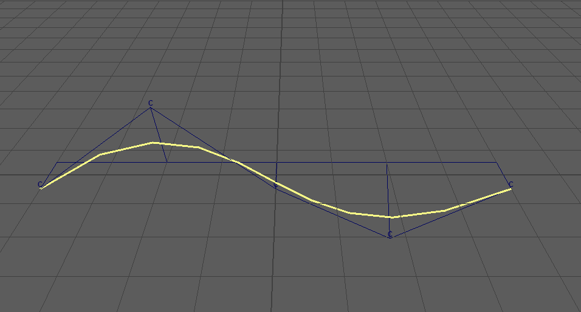

createCurveFromSelectedClusters
===============================

選んだクラスターの位置を、選んだ順に通る NURBS カーブを作るツールです。

開き方
------

HTools > rigging > createCurveFromSelectedClusters。

画面
----

画面はありません。選ぶとすぐにカーブを作ります。

使い方
------

1. カーブが通る順に、クラスターを選びます。クラスターハンドル(``cluster1Handle`` など)、
   そのシェイプ(clusterHandle)、cluster ノードのどれを選んでもかまいません。
2. メニューから選びます。
3. 各クラスターハンドルのワールドの回転ピボットの位置を CV にした、次数3のカーブ ``clusterPath_crv`` ができ、選択されます。
   Script Editor に CV の座標(``points: ...``)を出します。

上の例では、帯の頂点に付けた5つのクラスター(C の印)を左から順に選んで作りました。
クラスターの位置は CV(制御点)なので、カーブは CV の近くをなめらかに通ります(位置そのものは通りません)。

注意・制限
----------

- クラスターではないものは ``Skipped a node that is not a cluster: ...`` の警告を出して飛ばします。
- 同じクラスターを2回選んでも1つとして扱います(最初に選んだ順番を使います)。
- クラスターが2つ未満だと ``Two or more clusters are required.`` の警告を出して何もしません。
- クラスターが3つのときは次数2、2つのときは次数1(直線)になります(次数は「点の数 - 1」以下にします)。
- カーブはクラスターと接続しません(作ったときの位置で固定です)。
- Undo できます。カーブの作成と選択が別の手順なので、元に戻すには2回 Undo します。
