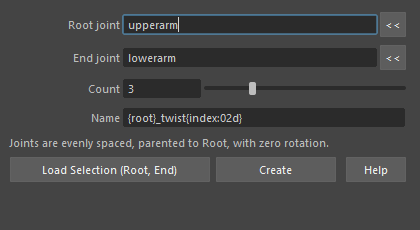
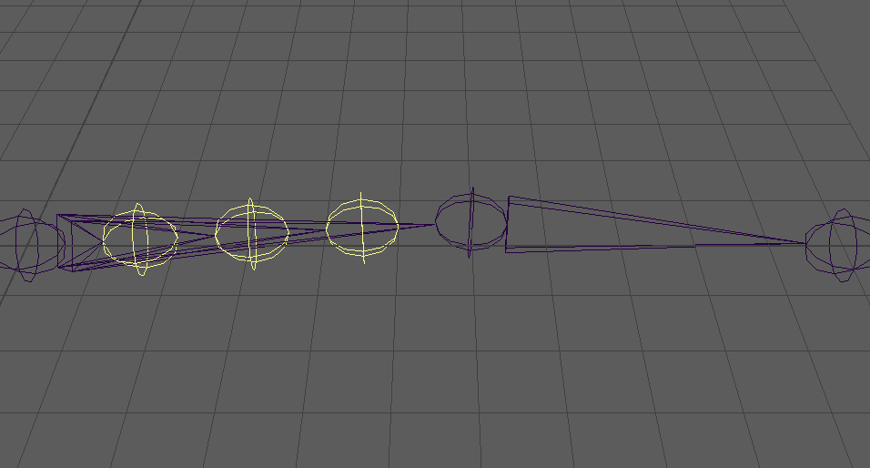

createTwistJoints
=================

根本(Root)と末端(End)の2つのジョイントの間に、ツイスト用のジョイントを均等な間隔で作るツールです。
作ったジョイントは根本の子で、回転・ジョイントの向き(jointOrient)・回転軸(rotateAxis)が 0 です(向きは根本と同じ)。

開き方
------

根本 → 末端の順に2つのジョイントを選んでから、HTools > rigging > createTwistJoints。
「Create Twist Joints」の画面が開き、選択した2つを Root joint・End joint に入れます。

画面
----

.. list-table::
   :header-rows: 1
   :widths: 30 70

   * - 項目
     - 内容
   * - Root joint
     - 根本のジョイント。\ ``<<`` で選択中の最初のノードを入れます。
   * - End joint
     - 末端のノード。位置だけを使います(ジョイント以外の transform でもかまいません)。\ ``<<`` で選択中の最初のノードを入れます。
   * - Count
     - 作る個数。スライダーは 1〜10、数値欄には 100 まで入れられます(既定 3)。
   * - Name
     - 名前の書式。\ ``{root}`` は根本の短い名前(名前空間なし)、\ ``{index}`` は 1 から始まる番号に置き換わります。
       既定は ``{root}_twist{index:02d}``\ (例: ``upperarm_twist01``)。空にすると既定の書式を使います。
   * - Load Selection (Root, End)
     - 選択した2つを、選んだ順に Root joint・End joint へ入れます。
   * - Create
     - ツイストジョイントを作ります。
   * - Help
     - このページを開きます。

使い方
------

1. 根本 → 末端の順にジョイントを選んでツールを開きます(開いた後なら Load Selection か ``<<`` で入れます)。
2. Count と Name を決めます。
3. Create を押します。根本と末端を結ぶ直線を「個数 + 1」等分した位置に、根本の子のジョイントができます。

上の例では、upperarm と lowerarm の間に3つ(黄色)を作りました(色は分かりやすくするために付けたもので、ツールは色を付けません)。

注意・制限
----------

- 末端が根本の直下の子でなくても、2点を結ぶ直線上に並べます。
- 作ったジョイントの rotateOrder は根本に合わせ、半径(radius)は根本と同じにします。
- 1回の Undo で全部を取り消せます。作り終わると、元の選択に戻します。
- 次の場合は作らずに警告を出します: Root joint・End joint が空、根本がジョイントでない、根本と末端が同じノード、
  2つが同じ位置、ノードが見つからない・名前が一意でない、個数が 1〜100 の外、名前の書式が正しくない。
- スクリプトからは ``createTwistJoints(root, end, count=3, name=..., radius=None)`` を呼べます(作ったジョイントのフルパスを返します)。
