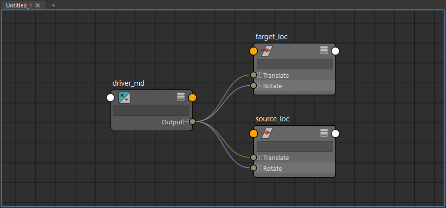

duplicateInputsFromFirstToSecond
================================

1つ目に選んだノードへの入力接続を、2つ目に選んだノードの同じ名前のアトリビュートにもつなぐツールです。
1つ目の接続はそのまま残り、結果をビューポートのメッセージで知らせます。

開き方
------

HTools > rigging > duplicateInputsFromFirstToSecond。

画面
----

画面はありません。選ぶとすぐに処理します。

使い方
------

1. 元のノードを選び、続けて先のノードを追加で選びます(1つ目 = 元、2つ目 = 先)。
2. メニューから選びます。
3. 元のノードへの入力接続をすべて調べ、同じ接続元を先のノードの同じ名前のアトリビュートへつなぎます。
4. ビューポートの上に ``Inputs duplicated: connected N / skipped N / failed N`` と結果を表示します。
   connected はつないだ数、skipped は同じ接続が既にあって飛ばした数、failed はつなげなかった数です。

上の例では、source_loc の translateX・rotateY の入力を target_loc にもつなぎました
(target_loc の rotateY には元から別の入力があったため、その1件は failed になり、元の接続が残っています)。

copyIncomingConnectionsFromFirstToSecond との違い
--------------------------------------------------

.. list-table::
   :header-rows: 1
   :widths: 30 35 35

   * -
     - duplicateInputsFromFirstToSecond
     - :doc:`copyIncomingConnectionsFromFirstToSecond`
   * - 調べる接続
     - 元のノードへの入力接続(listConnections)
     - 元のノードの全アトリビュートを1つずつ調べる
   * - 結果の知らせ方
     - ビューポートのメッセージ(件数)
     - Script Editor に一覧
   * - 先に同じ名前のアトリビュートが無いとき
     - failed として数える
     - skipped に記録
   * - 先に別の入力があるとき
     - 置き換えない(failed)
     - 置き換えない(errors)。スクリプトから ``force=True`` で置き換え可

注意・制限
----------

- 2つ以上選んでいないとエラー(``Select two nodes (first = source, second = destination).``)になります。3つ目以降は使いません。
- 元に入力接続が1つも無い場合は ``No incoming connections found on the source node.`` の警告を出して終わります。
- 先のアトリビュートがロックされている、別の入力が既にある、同じ名前のアトリビュートが無い場合は、
  その接続だけ ``Connection failed: ...`` の警告を出して数え、ほかの接続は続けます。
- 全部の接続をまとめて1回の Undo で戻せます。
- スクリプトからは ``duplicate_all_inputs_from_first_to_second(source, target)`` でノードを直接指定できます。
