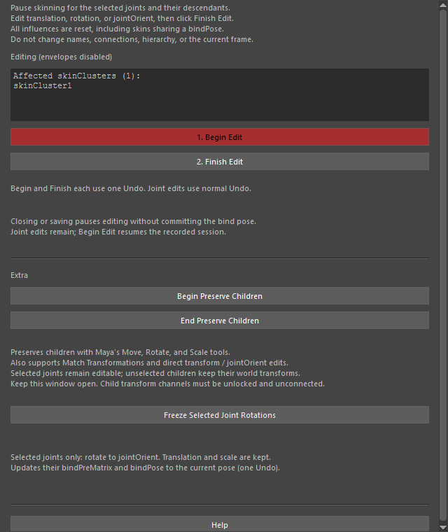
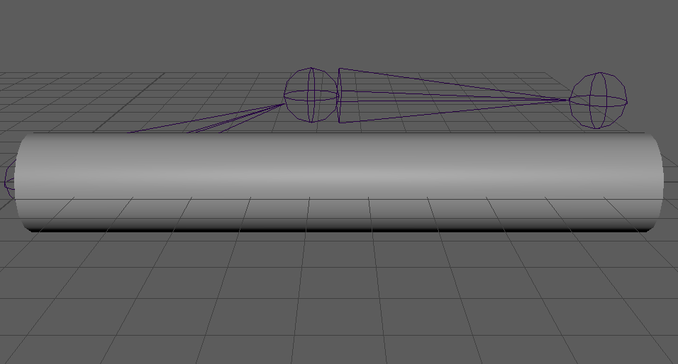

editSkinJoints
==============

スキンを付けた後で、メッシュの形を変えずにジョイントの位置・向きを直すツールです。
編集中はスキンの変形を止め(envelope を 0)、終わったら今のジョイントの姿勢をバインドの基準として登録し直します。
ウェイトは変えません。

開き方
------

HTools > rigging > editSkinJoints。「Edit Skin Joints」の画面が開きます。

画面
----

.. list-table::
   :header-rows: 1
   :widths: 35 65

   * - 項目
     - 内容
   * - 状態の表示
     - ``Ready``\ (待機)、\ ``Editing (envelopes disabled)``\ (編集中)、
       ``Paused / recovered: ...``\ (一時停止中。Begin Edit で再開、Finish Edit で確定)。
   * - Affected skinClusters
     - 編集の対象になっている skinCluster の一覧。
   * - 1. Begin Edit
     - 選んだジョイントとその子孫につながった skinCluster の変形を止め、編集を始めます。編集中はボタンが赤くなります。
       一時停止中の編集があれば、それを再開します。
   * - 2. Finish Edit
     - 今のジョイントの姿勢を基準にバインド情報(bindPreMatrix と bindPose)を作り直し、envelope を元の値に戻します。
   * - Begin Preserve Children
     - 子を動かさずに親のジョイントだけを動かせるようにします。Maya の移動・回転・スケールツールの
       「子の位置を保持(Preserve Children)」をオンにし、さらに Channel Box などで直接値を変えた場合や
       Match Transformations でも、選んでいない子のワールドの位置を保ちます。オンの間はボタンが赤くなります。
   * - End Preserve Children
     - Preserve Children をやめ、3つのツールの設定を始める前の状態に戻します。
   * - Freeze Selected Joint Rotations
     - 選んだジョイントの回転(rotate)をジョイントの向き(jointOrient)へ移して rotate を 0 にし、
       そのジョイントのバインド情報を今の姿勢で更新します。移動・スケールは変えません。
   * - Help
     - このページを開きます。

使い方
------

ジョイントの位置を直す
   1. 直したいジョイント(またはその親)を選び、1. Begin Edit を押します。
      選んだジョイントと子孫につながった skinCluster、さらに同じ bindPose を共有する skinCluster が対象になります。
   2. メッシュがバインドしたときの形で止まるので、ジョイントの移動・回転・jointOrient を直します(通常の Undo が使えます)。
   3. 2. Finish Edit を押します。メッシュはそのままの形で、新しいジョイントの位置で変形するようになります。

上の例は編集中に肘のジョイント(lowerarm)を上へ動かしたところで、メッシュは変形していません。

親だけを動かす
   Begin Preserve Children を押してから親のジョイントを動かすと、選んでいない子はワールドの位置に留まります。
   使い終わったら End Preserve Children を押します。この画面を開いている間だけ働きます。

回転を jointOrient へ移す
   ジョイントを選んで Freeze Selected Joint Rotations を押します(1回の Undo で戻せます)。

注意・制限
----------

- Begin Edit・Finish Edit はそれぞれ1回の Undo で戻せます。Undo が無効の状態では実行できません(``Enable Undo before running this tool.``)。
- 編集中は、名前・接続・階層・現在のフレームを変えないでください。Finish Edit は Begin Edit と同じフレームでないと実行できません
  (``Return to the frame where editing started.``)。インフルエンスの接続や bindPose の構成が変わっていると確定を断ります。
- 画面を閉じる、シーンを保存する、新しいシーンを開く・開き直すと、確定せずに一時停止します(envelope だけ元に戻します)。
  編集の記録はシーンの ``HToolsSkinJointEditSession``\ (network ノード)に残り、Begin Edit で再開できます。
  画面を開いたとき、止まったままの編集が残っていれば一時停止の状態にします。
- リファレンスの skinCluster・bindPose、ロックされた bindPose、つながっていないインフルエンスには対応していません。
  envelope・bindPreMatrix がロック・接続されている場合も実行できません。
- ジョイントのスケールが 0 に近いなど、行列の逆行列が求められないときはエラーになります。
- Preserve Children では、子の移動・回転・スケール・シアーのチャンネルがロック・接続されていないことが必要です。
  補正できなかったときは ``Child preservation failed. Undo the edit.`` の警告を出します。
- Maya が途中で終了して Preserve Children の設定が戻らなかった場合は、次にこの画面を開いたときに元の設定へ戻します。
