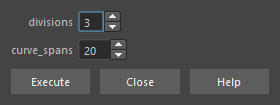
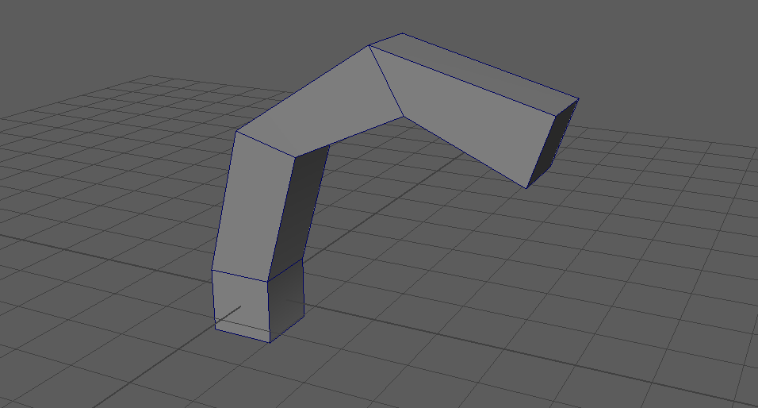

extrudeFaceAlongCurveEven
=========================

選んだフェースを、カーブに沿って押し出すツールです。押し出す前にカーブを均等な間隔で作り直す(rebuild)ので、
分割がカーブの長さに対して均等になります。

開き方
------

HTools > rigging > extrudeFaceAlongCurveEven。「Extrude Face Along Curve Even」の画面が開きます。

画面
----

.. list-table::
   :header-rows: 1
   :widths: 30 70

   * - 項目
     - 内容
   * - divisions
     - 押し出しの分割数(1〜200、既定 3)。
   * - curve_spans
     - 押し出す前にカーブを作り直すときのスパン数(1〜1000、既定 20)。
   * - Execute
     - 選択中のフェースとカーブで押し出します。
   * - Close
     - 画面を閉じます。
   * - Help
     - このページを開きます。

使い方
------

1. 押し出すフェースを選び、続けてガイドのカーブ(transform またはシェイプ)を追加で選びます。
2. divisions と curve_spans を決めて Execute を押します。
3. カーブが次数3・指定のスパン数で作り直され、フェースがカーブに沿って押し出されます。
   できた polyExtrudeFace ノードが選択され、ビューに ``Extrude completed`` と出ます。

上の例は、立方体の上の面を曲がったカーブに沿って divisions 3 で押し出したものです。

注意・制限
----------

- **ガイドのカーブそのものを作り直します**\ (履歴なしの rebuildCurve)。元のカーブの形を残したい場合は、複製してから使ってください。
- フェースを複数選んでも、押し出すのは最初の1つだけです。
- フェースが無い・カーブが無い場合は、\ ``No face is selected.``\ ・\ ``No curve is selected.`` などの警告を出して何もしません。
- 押し出しは作成履歴(polyExtrudeFace)付きなので、後から分割数などをアトリビュートで変えられます。
- カーブの作り直しと押し出しは別々の Undo になります(元に戻すには、選択の変更も含めて数回 Undo します)。
- PySide6 を使うため、Maya 2025 以降で動きます(Maya 2022〜2024 では開けません)。
