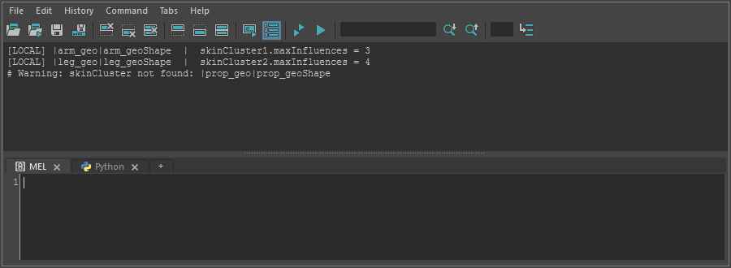

getMaxInfluencesFromSelection
=============================

選んだメッシュに付いている skinCluster の ``maxInfluences`` (1頂点あたりの最大インフルエンス数の設定)を、
Script Editor に一覧で出すツールです。シーンは変更しません。

開き方
------

HTools > rigging > getMaxInfluencesFromSelection

画面
----

画面はありません。メッシュを選んで実行すると、すぐに結果を Script Editor に出します。

使い方
------

1. 調べたいメッシュを選びます(複数可)。トランスフォーム・シェイプ・頂点などのコンポーネントのどれを選んでもよく、
   コンポーネントを選んだときはそのメッシュ全体を調べます。
2. メニューから実行します。
3. Script Editor に、メッシュのシェイプごとに次の形で1行ずつ出ます。

   ``[LOCAL] |arm_geo|arm_geoShape  |  skinCluster1.maxInfluences = 3``

   - 先頭の ``[LOCAL]`` はシーン内のメッシュ、``[REF]`` はリファレンスで読み込んだメッシュです。
   - 1つのシェイプに skinCluster が複数あるときは、すべてを1行ずつ出します。

注意・制限
----------

- 出すのは skinCluster の ``maxInfluences`` アトリビュートの値です。各頂点が実際にいくつのインフルエンスを
  持っているかを数えるものではありません。
- 中間オブジェクト(``intermediateObject`` が有効なシェイプ)は対象外です。
- 次のときは警告を出し、その対象を飛ばします。

  - 何も選んでいない: ``No object is selected.``
  - メッシュのシェイプが無い: ``Mesh shape not found: <名前>``
  - skinCluster が見つからない: ``skinCluster not found: <シェイプ>``

- skinCluster は、まずシェイプに直接つながったものを探し、無ければ作成履歴から探します。
