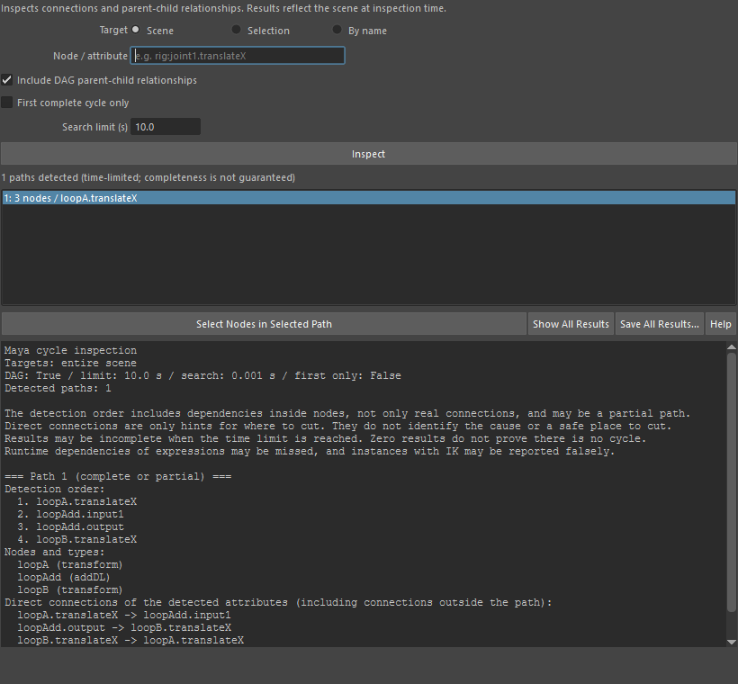

inspectCycles
=============

シーンの循環(サイクル)の候補を Maya の ``cycleCheck`` で探し、検出した順序・ノードと型・直接の接続・親子関係を
一覧にする調査用のツールです。シーンは変更しません(ノードの選択だけは変えられます)。

開き方
------

HTools > rigging > inspectCycles

「Cycle Inspector」ウィンドウが開きます。

画面
----

.. list-table::
   :header-rows: 1
   :widths: 30 70

   * - 項目
     - 説明
   * - Target
     - 調べる範囲。**Scene** はシーン全体、**Selection** は選んでいるノード、**By name** は下の欄に書いた名前。
   * - Node / attribute
     - By name のときに使う名前。ノード名(``rig:joint1``)またはアトリビュート名(``rig:joint1.translateX``)を
       空白で区切って複数書けます。
   * - Include DAG parent-child relationships
     - DAG の親子関係も検出に含めます(既定でオン)。
   * - First complete cycle only
     - 最初に見つかった完全なサイクル1つだけを探します。
   * - Search limit (s)
     - 検索の時間の上限(秒、既定 10)。0 より大きい値にします。
   * - Inspect
     - 上の条件で調べます。前の結果は消えます。
   * - (状態の表示)
     - 検出した経路の数など。時間の上限があるため、見落としが無いことは保証しません。
   * - (経路の一覧)
     - 見つかった経路ごとに「番号: ノード数 / 先頭のアトリビュート」を並べます。選ぶと、下の欄にその経路だけの詳細を
       出します(複数選択可)。
   * - Select Nodes in Selected Path
     - 一覧で選んだ経路に含まれるノードを、シーンで選びます。
   * - Show All Results
     - すべての経路の詳細を下の欄に出します。
   * - Save All Results…
     - すべての結果をテキストファイル(UTF-8)に保存します。
   * - Help
     - このページを開きます。
   * - (詳細の欄)
     - 調べた条件、制限の説明、経路ごとの「検出順」「ノードと型」「検出したアトリビュートの直接の接続」
       「親子関係」「読み取りの失敗」を出します。

使い方
------

1. Target を選びます(Selection ならノードを選んでおく、By name なら名前を書く)。
2. **Inspect** を押します。
3. 一覧で経路を選び、下の欄で接続を確かめます。**Select Nodes in Selected Path** で該当のノードを選び、
   Node Editor などで実際の接続を確認します。
4. 記録を残すときは **Save All Results…** で保存します。

注意・制限
----------

画面の下の欄にも英語で出ていますが、次のことに注意してください。

- 検出順はノードの中の依存関係も含み、実際の接続だけではありません。経路は一部だけのこともあります。
- 「直接の接続」は切る場所のヒントにすぎず、原因や安全に切れる場所を示すものではありません。
- 時間の上限に達すると結果が欠けることがあります。0件でも、サイクルが無いことの証明にはなりません。
- エクスプレッションの実行時の依存は見落とすことがあり、IK を使うインスタンスは誤って検出されることがあります。
- 結果は調べた時点のシーンのものです。シーンを変えたら調べ直してください。
- Selection で何も選んでいない、名前が見つからない・複数に当てはまる、時間の上限が 0 以下、のときは
  失敗し、理由を下の欄と警告に出します。
