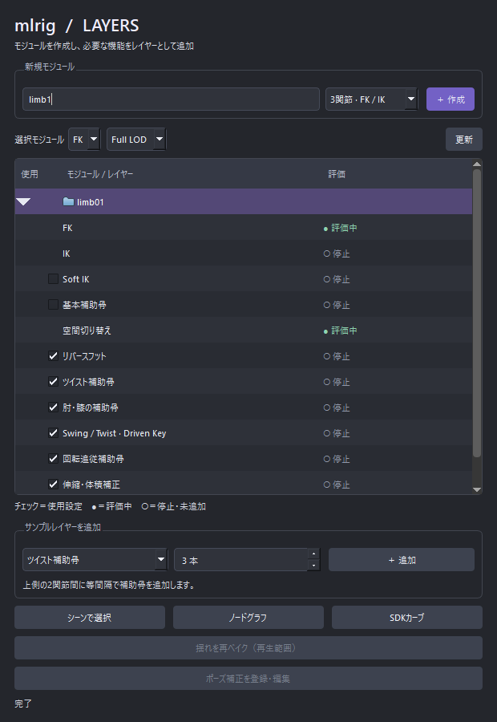

mlrigLayerEditor
================

mlrig のモジュール・レイヤーのサンプルエディター(``mlrig.show_layer_editor()``)を開く入口です。
エディター本体は mlrig にあり、詳しい内容は `mlrig のドキュメント <https://hsk0120.github.io/MayaHToolsWorkspace/mlrig/>`_
を参照してください。

開き方
------

HTools > rigging > mlrigLayerEditor

「mlrig / LAYERS」ウィンドウが開きます(すでに開いていれば同じウィンドウを前に出します)。
このウィンドウは mlrig のもので、画面の文字は日本語です。HTools の Help ボタンはありません。
このページは HTools メニューの Help から開けます。

画面
----

上は「3関節 · FK / IK」のモジュール ``limb01`` を作った直後の画面です。

.. list-table::
   :header-rows: 1
   :widths: 30 70

   * - 項目
     - 説明
   * - 新規モジュール
     - モジュール名と種類(3関節 · FK / IK、メッシュ付きデモ、スカート、背骨・尻尾の Spline IK、指、首・視線など)を
       選び、**＋ 作成** でシーンに作ります。スカート・Spline IK では骨の数などの欄が出ます。
   * - 選択モジュール
     - 一覧で選んだモジュールの FK / IK と LOD(Low / Full)を切り替えます。**更新** で一覧を読み直します。
   * - 一覧
     - モジュール(フォルダー)とレイヤーの行。チェックは使用の設定、● は評価中、○ は停止・未追加です。
       行をダブルクリックすると、そのノードをシーンで選びます。
   * - サンプルレイヤーを追加
     - 一覧で選んだモジュールに、ツイスト補助骨・揺れ物・ポーズ補正などのレイヤーを追加します。
   * - シーンで選択 / ノードグラフ / SDKカーブ
     - 選んだ行のノードを選ぶ、ノードの接続を表示する、Set Driven Key のカーブを開きます。
   * - 揺れを再ベイク(再生範囲) / ポーズ補正を登録・編集
     - 揺れ物のベイクのやり直しと、ポーズ補正(RBF)の編集です。

注意
----

- mlrig と mlib が読み込める環境が必要です(このワークスペースの起動バッチで起動した Maya なら読み込めます)。
- 各機能の詳しい仕様・制限は mlrig のドキュメントを参照してください。
