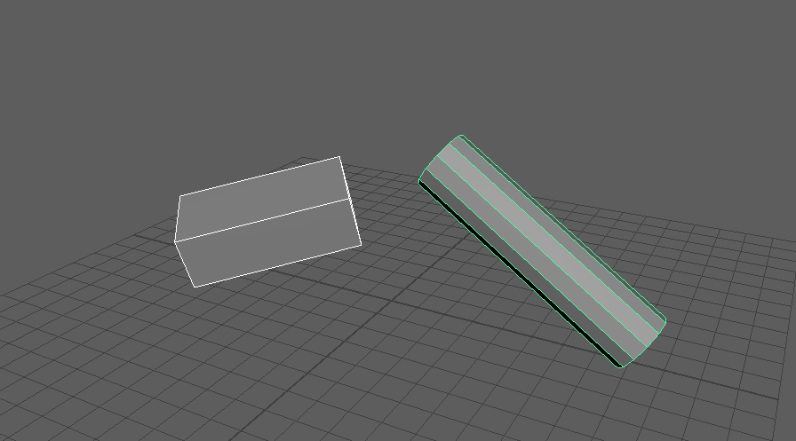
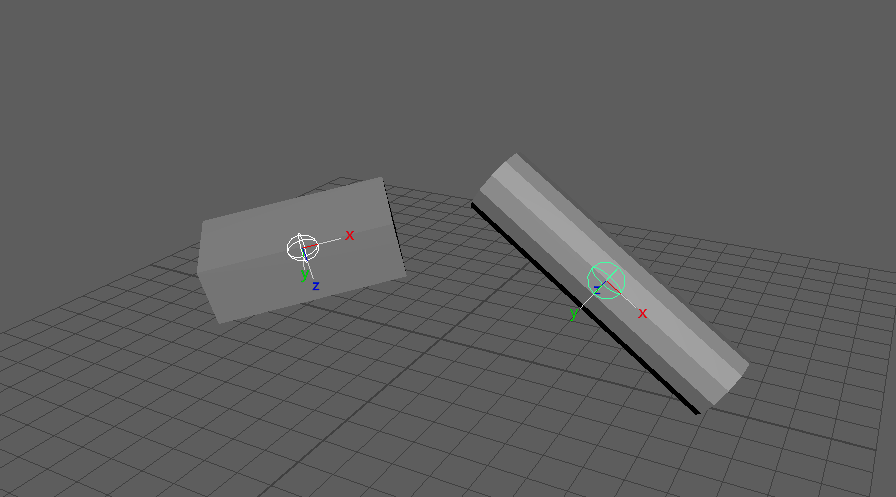

obbJointFromSelection
=====================

選んだメッシュごとに、メッシュを包む向き付きの箱(OBB)の中心と向きでジョイントを1本作り、
そのジョイント1本に 100% でスキンを付け直すツールです。

開き方
------

HTools > rigging > obbJointFromSelection

画面
----

画面はありません。メッシュを選んで実行すると、すぐに処理します。

上が実行前、下が実行後です(下はジョイントのローカル軸を表示しています)。

使い方
------

1. メッシュ(トランスフォーム、またはメッシュの頂点)を選びます。複数選ぶと、メッシュごとに1本ずつ作ります。
2. メニューから実行します。
3. 各メッシュに対して、次のことを行います。

   - :doc:`simpleCollisionFromSelection` と同じ計算で OBB を求めます(一時的に箱のメッシュを作り、最後に消します)。
   - OBB の中心に、OBB の軸を向いたジョイントを作ります。X はメッシュの長手方向(主成分分析の長軸から調整した向き)
     です。回転はフリーズして
     ``jointOrient`` に入れるので、``rotate`` は 0 になります。
   - メッシュに skinCluster があれば外し(unbind)、新しいジョイント1本だけで 100% のスキンを付けます。

4. 作った数を ``Created joints: ... / Bound meshes: ... / Deleted collisions: ...`` と出します。

名前は ``obbCollision_jnt`` です。複数のメッシュを処理したときは ``obbCollision_jnt_01``、``_02`` … になります。

注意・制限
----------

- 既存のスキンは外されます。元のウェイトは残りません。
- 頂点を選んだ場合も、選んだ頂点ではなく、そのメッシュの全頂点から OBB を求めます(頂点の選択は対象のメッシュを
  決めるためだけに使います)。スキンもメッシュ全体に付けます。
- 全メッシュの処理は1回の Undo で戻せます。処理の後、選択は実行前の状態に戻ります。
- メッシュが選ばれていないとエラー(``Select mesh object or mesh vertices.``)、1本も作れなかったときも
  エラーを出します。
