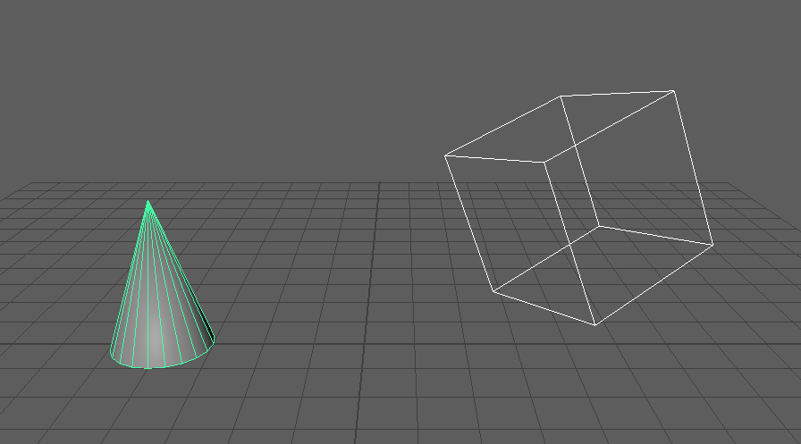
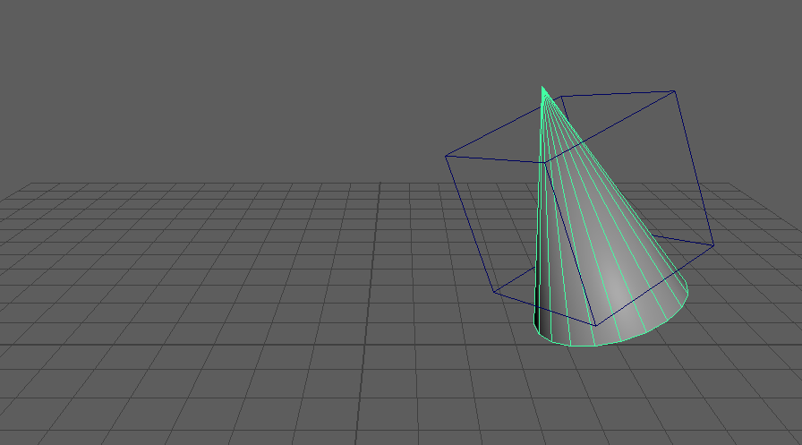

parentScaleConstraintOffset0
============================

2つ選んだノードの間に、オフセット無し(Maintain Offset オフ)の parentConstraint と scaleConstraint を作るツールです。
子は親の位置・回転・スケールにそのまま重なります。

開き方
------

HTools > rigging > parentScaleConstraintOffset0

画面
----

画面はありません。2つ選んで実行すると、すぐに処理します。

上が実行前、下が実行後です(子が見えるよう、親の箱は線だけで表示しています)。

使い方
------

1. 親にするノード、子にするノードの順に2つ選びます。
2. メニューから実行します。
3. 子に parentConstraint と scaleConstraint ができ、
   ``Created parentConstraint / scaleConstraint with offset 0: <子> <- <親>`` と出ます。

注意・制限
----------

- ちょうど2つ選んでいないときは警告(``Select two nodes in order: parent, then child.``)を出して何もしません。
- 2つともトランスフォーム(ジョイントを含む)である必要があります。そうでないときは警告を出して何もしません。
- 2つのコンストレイントは1回の Undo で戻せます。
