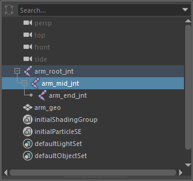
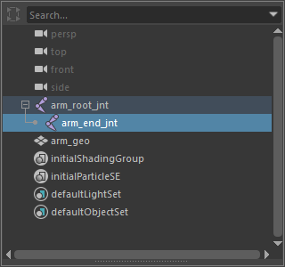

removeSelectedJoints
====================

選んだジョイントを削除するツールです。削除する前に、そのジョイントのスキンウェイトを同じ skinCluster の
一番近い祖先のインフルエンスへ足し込み、子のトランスフォームは削除するジョイントの親へ付け替えます。

開き方
------

HTools > rigging > removeSelectedJoints

画面
----

画面はありません。ジョイントを選んで実行すると、すぐに処理します。

上が実行前(``arm_mid_jnt`` を選択)、下が実行後です。3本のジョイントでスキンを付けた円柱で試すと、ある頂点の
ウェイト(root / mid / end)が 0.961 / 0.038 / 0.001 から、root / end の 0.999 / 0.001 になりました
(mid の分が root に足されます)。

使い方
------

1. 削除したいジョイントを選びます(複数可。ジョイント以外の選択は無視します)。
2. メニューから実行します。
3. 深い階層のジョイントから順に、次のことを行います。

   - そのジョイントがインフルエンスになっている skinCluster ごとに、親をジョイントだけたどって、
     同じ skinCluster のインフルエンスになっている一番近い祖先を探します。
   - 見つかったら、各頂点で「祖先のウェイト + 削除するジョイントのウェイト」を祖先に入れ、削除するジョイントを 0 に
     してから、インフルエンスから外します。他のインフルエンスの値は変えないので、頂点ごとの合計は変わりません。
   - 子のトランスフォーム(ジョイントを含む)を、削除するジョイントの親へ(親が無ければワールドへ)付け替えます。
   - ジョイントを削除します。

注意・制限
----------

- 全体を1回の Undo で戻せます。途中で失敗すると例外で止まり、それまでの変更は自動では戻りません(Undo で戻せます)。
- 祖先のインフルエンスが見つからない skinCluster では、ウェイトを移さず Maya の標準の削除に任せます。
- スキンのウェイトを取らないジョイントも削除します。
- 次のときは安全のため処理しません。

  - skinCluster にスキニングレイヤー(ngSkinTools など、名前・型名で判定)がつながっている:
    ``Cannot run because skinning layers exist.``
  - 移す元・先のインフルエンスのウェイトがロックされている: ``Influence is locked: <名前>``
  - skinCluster のウェイトがロック、または入力がつながっている: ``Weights are locked or connected``

- ジョイントを何も選んでいないときは、何もしません。
