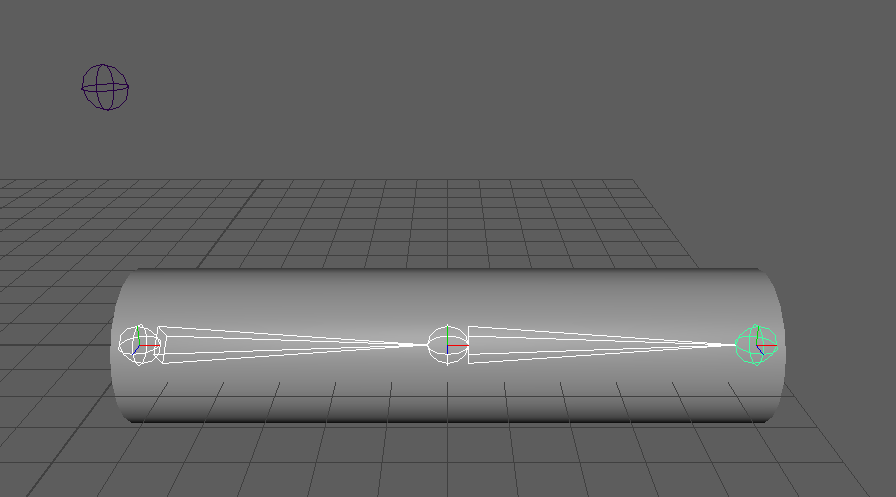
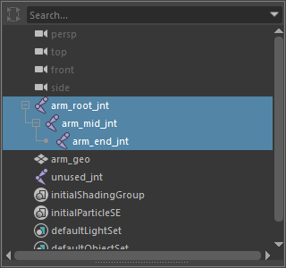

selectSkinningJoints
====================

選んだメッシュの skinCluster のインフルエンス(スキンを動かしているジョイント)をすべて選ぶツールです。

開き方
------

HTools > rigging > selectSkinningJoints

画面
----

画面はありません。メッシュを選んで実行すると、すぐに選択を置き換えます。

スキンに使われている3本のジョイントが選ばれ、使われていない ``unused_jnt`` は選ばれていません。

使い方
------

1. スキンの付いたメッシュ(トランスフォーム)を選びます。
2. メニューから実行します。
3. そのメッシュの skinCluster のインフルエンスがすべて選ばれます(今の選択は置き換わります)。
   名前が重複していても、フルパスで正しく選びます。

注意・制限
----------

- 複数選んでいても、最初に選んだ1つだけを使います。シェイプの最初の1つの作成履歴から skinCluster を探し、
  複数ある場合は最初の1つを使います。
- 次のときはエラーを出します。

  - 何も選んでいない: ``No mesh is selected.``
  - 選んだものにシェイプが無い(シェイプのノード自体を選んだときも含む): ``The selected object has no shape.``
  - skinCluster が見つからない: ``skinCluster not found.``

- インフルエンスにジョイント以外のトランスフォームがあれば、それも選ばれます。
