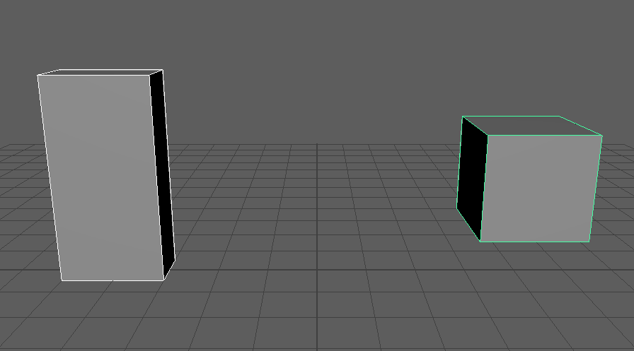
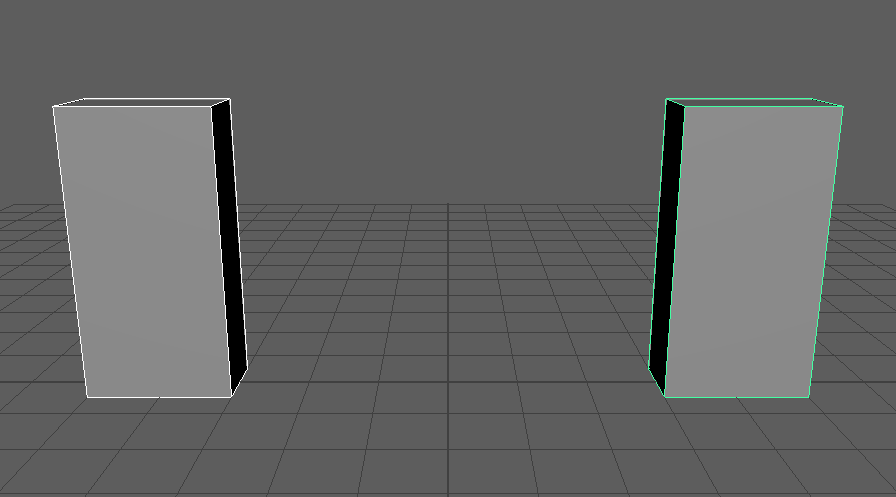

setScaleFromSelection
=====================

1つ目に選んだオブジェクトのワールドでのスケールを、2つ目に選んだオブジェクトへコピーするツールです。
2つ目の親にスケールがあっても、見た目(ワールド)のスケールがそろうようにローカルの ``scale`` を計算して入れます。

開き方
------

HTools > rigging > setScaleFromSelection

画面
----

画面はありません。2つ選んで実行すると、すぐに処理します。

上が実行前、下が実行後です。右の箱は親のグループにスケール 2 が入っているので、ワールドで (1, 2, 0.5) に
そろえるために、ローカルの ``scale`` は (0.5, 1, 0.25) になります。

使い方
------

1. コピー元、コピー先の順に2つ選びます。
2. メニューから実行します。
3. コピー先の ``scaleX``・``scaleY``・``scaleZ`` が設定されます。

注意・制限
----------

- 1回の Undo で戻せます。
- 変えるのはコピー先の ``scale`` だけです。位置・回転は変えません。
- スケールはワールド行列を分解して求めます。親に回転とばらばらのスケールが重なっているなど、シアーが出る
  階層では、見た目が完全にはそろわないことがあります。
- 2つ以上選んでいないとき、DAG のノード以外を選んでいるときは、Python のエラーになります。
  3つ以上選んでいるときは、最初の2つだけを使います。
- ``scale`` がロック・接続されているとエラーになります。
