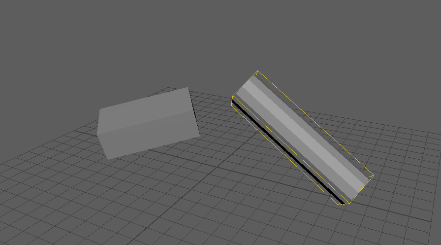

simpleCollisionFromSelection
============================

選んだメッシュ(または頂点)を包む、向き付きの箱(OBB)のメッシュを作るツールです。
コリジョンの形のたたき台や、向きの確認に使います。

開き方
------

HTools > rigging > simpleCollisionFromSelection

画面
----

画面はありません。メッシュを選んで実行すると、すぐに箱を作ります。

傾いた円柱を選んで実行した結果です(作った箱は、見やすいように黄色の線だけで表示しています)。

使い方
------

1. メッシュのトランスフォーム、または頂点を選びます。
2. メニューから実行します。
3. ``obbCollision_geo`` という箱のメッシュができ、
   ``Created OBB collision: obbCollision_geo (size: X, Y, Z, points: 使った点の数/全体の点の数)`` と出ます。

箱の向きと大きさの決め方:

- 点が多いときは、64 の向きでいちばん外側の点を拾って外形を近似し、計算を軽くします。
- 主成分分析で長軸を決め、短い2軸の向きと全体の向きを、箱の体積が小さくなるように少しずつ回して調整します。
  最小の体積の厳密な答えではありません。
- 箱は、大きさ 1 の立方体に回転とスケールを入れて作ります。トランスフォームの ``rotate``・``scale`` に
  向きと寸法が入り、ピボットは箱の中心です(フリーズはしません)。

注意・制限
----------

- 選んだものはすべて合わせて1つの箱にします。複数のメッシュを選ぶと、全体を包む箱が1つできます。
  メッシュごとに作るときは1つずつ実行してください(ジョイントとして使うなら :doc:`obbJointFromSelection`)。
- 頂点を選んだときは、選んだ頂点だけを使います。辺・面を選んだときは、そのメッシュの全頂点を使います。
- 点が3つ未満のときはエラー(``Select mesh object or mesh vertices (3 points minimum).``)を出します。
- 作成は1回の Undo で戻せます。作った箱は作成履歴を持たない普通のメッシュです。
- 同じ名前があると、Maya の決まりで ``obbCollision_geo1`` のような名前になります。
