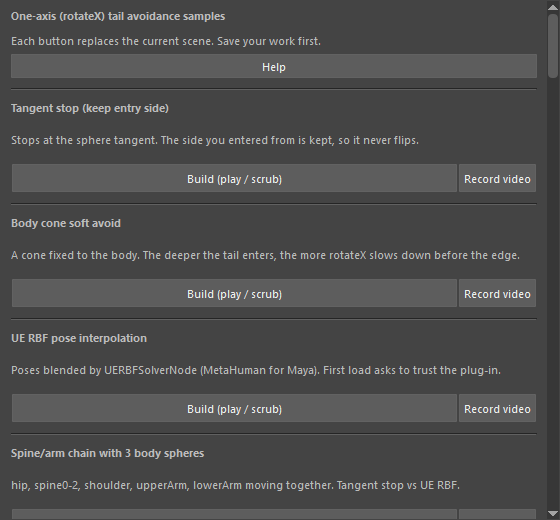

tailAvoidanceSamples
====================

尻尾のような骨を1軸(``rotateX``)だけで回して体をよける仕組みの、検証サンプルの一覧ウィンドウです。
ボタンを押すと、そのサンプルのシーンを作る(Build)か、録画して数値を検証します(Record video)。

開き方
------

HTools > rigging > tailAvoidanceSamples

「Tail Avoidance Samples」ウィンドウが開きます。サンプルが多いので、ウィンドウはスクロールします。

画面
----

.. list-table::
   :header-rows: 1
   :widths: 30 70

   * - 項目
     - 説明
   * - Help
     - このページを開きます。
   * - (サンプルの見出しと説明)
     - サンプルごとの内容(30件)。接線で止める方法、体に付けたコーン、UE の RBF、ConeReader、腕のツイストの打ち消し、
       レイヤー構造などを並べています。
   * - Build (play / scrub)
     - 録画せずにシーンを作ります。タイムラインを再生・スクラブすると、HUD の式と数値が変わる様子を確かめられます。
   * - Record video
     - シーンを作って録画し、数値を検証します。結果はワークスペースの ``.maya-output/verification/`` に保存します。
   * - Checks の Run check
     - 自動の検証(2件)。MetaHuman の Pose Editor でポーズを1つ編集し、尻尾が追従するかを確かめ、
       JSON のレポートと Pose Editor の画面を保存します。

使い方
------

1. 作業中のシーンを保存します(どのボタンもシーンを新しく作り直します)。
2. 見たいサンプルの **Build (play / scrub)** を押し、タイムラインを再生・スクラブして確かめます。
3. 動画と数値の記録が必要なら **Record video** を押します。

注意・制限
----------

- 未保存の変更があるときは、作り直してよいかを確認するダイアログ(Continue / Cancel)が出ます。
- サンプル本体はワークスペースの ``tools/demo_*.py``・``tools/verify_*.py`` にあり、このウィンドウはそれを
  読み込んで呼ぶだけです。ワークスペースの ``tools`` フォルダーが必要です。押すたびに最新の内容を読み込み直します。
- 別のサンプルのウィンドウが開いていれば閉じ、そのサンプルが変えた HUD を元に戻してから作ります。
- Record video には FFmpeg が必要です。環境変数 ``MAYA_VERIFICATION_FFMPEG`` に ``ffmpeg.exe`` のパスを入れるか、
  ワークスペースの ``.maya-output`` の下に ``imageio_ffmpeg`` を置きます。見つからないときは警告を出して録画しません。
- UE の RBF を使うサンプルと Checks は、MetaHuman for Maya のプラグイン(``MayaUERBFPlugin``)を読み込みます。
  初めて読み込むときは、プラグインを信頼するかの確認が出ます。
- 検証動画の撮り方の決まりは、ワークスペースの ``docs/verification-videos.md`` にあります。
