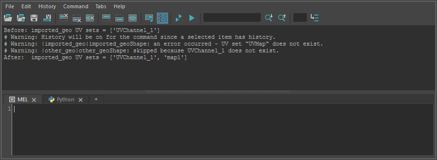

transferUvchannelToMap
======================

FBX などから取り込んだメッシュで UV セットが ``UVChannel_1`` という名前になっているとき、その UV を ``map1`` に
移し、``UVChannel_1`` を削除するためのツールです。

.. warning::

   Maya 2027 で確認した時点では、UV のコピーが失敗し、``map1`` が空のまま作られて ``UVChannel_1`` が残ります
   (下の画面を参照)。コピー先に、存在しない ``UVMap`` という UV セットを指定しているためです。
   直るまでは、UV Set Editor で ``UVChannel_1`` の名前を ``map1`` に変えるなど、手作業で対応してください。

開き方
------

HTools > rigging > transferUvchannelToMap

画面
----

画面はありません。メッシュを選んで実行すると、すぐに処理し、結果を Script Editor に出します。

UV セットが ``UVChannel_1`` だけのメッシュと、``map1`` だけのメッシュを選んで実行したときの出力です
(前後の ``Before:``・``After:`` の行は、確認のために別に出したものです)。

使い方(本来の動作)
--------------------

1. メッシュを選びます(トランスフォームでもシェイプでもよく、複数可)。
2. メニューから実行します。
3. ``UVChannel_1`` を持つメッシュごとに、次のことを行います。

   - ``map1`` が無ければ作ります。
   - ``UVChannel_1`` の UV をコピーし、``map1`` を現在の UV セットにしてから ``UVChannel_1`` を削除します。
   - 成功すると ``Done: <シェイプ> | UVChannel_1 -> map1 transferred, then deleted`` と出ます。

注意・制限
----------

- ``UVChannel_1`` が無いメッシュは警告(``skipped because UVChannel_1 does not exist.``)を出して飛ばします。
- メッシュが選ばれていない、選んだものにメッシュが無いときは警告を出して何もしません。
- メッシュごとの処理で失敗すると、警告(``an error occurred - <理由>``)を出して次のメッシュへ進みます。
  そこまでに作った ``map1`` は残ります。
- 作成履歴のあるメッシュでは、UV の操作も作成履歴に残ります。
