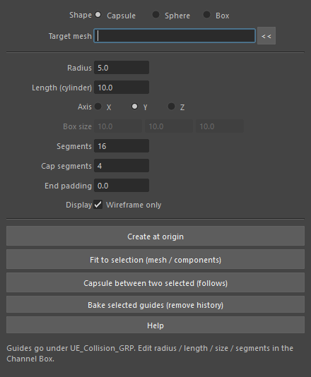
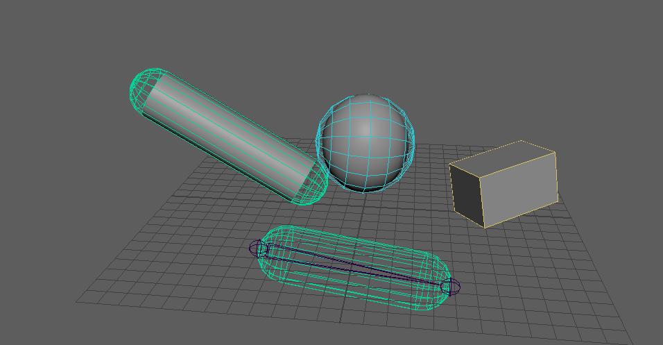

ueCollisionGuide
================

Unreal Engine のコリジョン(カプセル・球・箱)の形をしたガイドメッシュを作るツールです。
半径・長さ・分割数・箱の寸法はトランスフォームのアトリビュートにつながっていて、作った後もチャンネルボックスで
変えられます。名前は UE の FBX 取り込みの決まり(``UCP_``・``USP_``・``UBX_`` + 対象のメッシュ名 + ``_01``)に
合わせます。

開き方
------

HTools > rigging > ueCollisionGuide

「UE Collision Guide」ウィンドウが開きます。

画面
----

.. list-table::
   :header-rows: 1
   :widths: 30 70

   * - 項目
     - 説明
   * - Shape
     - 作る形。**Capsule**・**Sphere**・**Box**。選んだ形に関係する欄だけが使えるようになります。
   * - Target mesh
     - 名前に使う対象のメッシュ名。**<<** で選んでいるオブジェクトの名前を入れます。空のときは、
       Fit to selection では包んだ(最初の)メッシュの名前、2つの間のカプセルでは根本のトランスフォームの名前、
       原点に作るときは ``collision`` を使います。
   * - Radius
     - 半径(カプセル・球)。シーンの長さの単位です。
   * - Length (cylinder)
     - カプセルの円柱部分の長さ。両端の半球を含みません(UE の Length と同じ)。全体の長さは
       ``Length + 2 × Radius`` です。
   * - Axis
     - 原点に作るカプセルの軸(X・Y・Z)。
   * - Box size
     - 箱の X・Y・Z の寸法。
   * - Segments
     - 周りの分割数(カプセル・球)。
   * - Cap segments
     - カプセルの半球の分割数。球では、この2倍(最小 4)を縦の分割数に使います。
   * - End padding
     - 2つのジョイントの間に作るカプセルで、両端をそれぞれ延ばす量(負の値で縮める)。
   * - Display / Wireframe only
     - オンなら、シェーディングせず線だけで描きます(中のメッシュが見えます)。
   * - Create at origin
     - 上の値で原点にガイドを作ります。
   * - Fit to selection (mesh / components)
     - 選んだメッシュ・頂点・辺・面を包むガイドを作ります。
   * - Capsule between two selected (follows)
     - 選んだ2つのトランスフォーム(ジョイントなど)の間に、追従するカプセルを作ります。Shape が Capsule のときだけ
       使えます。
   * - Bake selected guides (remove history)
     - 選んだガイドを固定のメッシュにします(作成履歴・コンストレイント・追加のアトリビュートを消します)。
   * - Help
     - このページを開きます。

左上から、斜めの円柱を包むカプセル(``UCP_arm_geo_01``)、球を包む球(``USP_head_geo_01``)、傾いた箱を包む箱
(``UBX_crate_geo_01``)、手前が2つのジョイントの間で追従するカプセル(``UCP_thigh_jnt_01``)です。

使い方
------

原点に作る
   形と寸法を決めて **Create at origin** を押します。

選んだものを包む
   メッシュ、または頂点・辺・面を選んで **Fit to selection** を押します。向きは、点を包む向き付きの箱
   (:doc:`simpleCollisionFromSelection` と同じ計算)の軸に合わせます。

   - カプセル: 一番長い向きを軸にし、軸から一番遠い点までを半径にして、どの点も両端の半球に収まる範囲で
     円柱部分をできるだけ短くします。円柱部分が要らないときは球に近いカプセル(長さ 0)になります。
   - 球: 箱の中心から一番遠い点までを半径にします。
   - 箱: 向き付きの箱の寸法そのままです。

2つのジョイントの間に作る
   根本、先端の順に2つのトランスフォームを選び、**Capsule between two selected (follows)** を押します。
   中心は2点の中点(pointConstraint)、軸(ローカル Y)は先端へ向き(aimConstraint)、円柱部分の長さは
   ``2点の距離 + 2 × End padding - 2 × Radius`` (0 未満にはしない)をエクスプレッションで計算します。
   End padding が 0 なら、全体の長さが2点の距離になります。ジョイントを動かすと追従します。

作った後
   ガイドは ``UE_Collision_GRP`` の下に入ります。チャンネルボックスの ``radius``・``length``・``segments``・
   ``capSegments``・``rings``・``sizeX/Y/Z``・``endPadding`` を変えると、その場で形が変わります。

注意・制限
----------

- 作成・Fit・2点の間・Bake は、それぞれ1回の Undo で戻せます。
- UE はこの名前のメッシュの形からコリジョンを作るので、書き出す前に作成履歴やコンストレイントを消す必要は
  ありません。作成履歴を残したくないときだけ Bake を使います。
- 名前の番号は、まだ使われていない一番小さい番号になります(``_01``、``_02`` …)。
- ガイドはレンダリングに映らず(影・反射なども無効)、形ごとの色で表示します。
- Fit to selection は点が3つ未満だと警告を出して作りません。2つの間のカプセルは、ちょうど2つのトランスフォームを
  選んでいないとき、2点が同じ位置のときに警告を出して作りません。
- Bake は、このツールで作ったガイド(``ueCollisionShape`` アトリビュートを持つもの)だけが対象です。
- 2つの間のカプセルは、2点の位置を取るために標準の ``matrixNodes`` プラグインを読み込みます。
