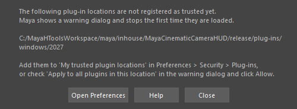

checkWorkspacePluginTrust
=========================

ワークスペースの C++ プラグイン(``.mll``)の置き場所が、Maya の「信頼済みプラグインの場所」に登録されているか確かめます。
確かめて知らせるだけで、設定は変えません。

Maya は、信頼されていない場所のプラグインを初めて読み込むときに警告ダイアログを出し、その間 GUI
(と commandPort 経由で送ったスクリプトの実行)が止まります。先に未登録の場所を調べておくと、作業中に急に止まるのを防げます。

開き方
------

HTools > system > checkWorkspacePluginTrust。実行するとすぐに調べます。

調べる対象
----------

環境変数 ``MAYA_PLUG_IN_PATH`` のフォルダーのうち、ワークスペースの ``maya/inhouse`` の下にあり、
``.mll`` を含むものです。``maya/external`` の下の外部ツールのプラグインは対象にしません(登録するかは各自で判断してください)。

結果
----

すべて登録済みなら、Script Editor に ``# All plug-in locations in the workspace are registered as trusted.`` と出して終わります。

未登録の場所があると、Script Editor に一覧を出し、次のダイアログを開きます。

.. list-table::
   :header-rows: 1
   :widths: 25 75

   * - ボタン
     - 内容
   * - Open Preferences
     - Maya の Preferences を開きます。Security > Plug-ins で登録します(下の「登録のしかた」)。
   * - Help
     - このページを開きます。
   * - Close
     - 閉じます。

登録のしかた
------------

Maya はスクリプトから信頼済みの場所を変えることを拒否する(SafeMode)ため、このツールは登録しません。次のどちらかで、各フォルダー1回だけ登録します。

* Preferences > Security > Plug-ins の「My trusted plugin locations」で Add を押し、一覧のフォルダーを追加する。
* プラグインを読み込んだときの警告ダイアログで「Apply to all plugins in this location」にチェックを入れて Allow を押す。

プラグインのフォルダーは Maya のバージョンごとに分かれているので、使うバージョンの分だけ登録します。

注意
----

* 読み取りだけのツールです。シーンや設定は変えません。
* バッチモード(mayapy など)ではダイアログを出さず、Script Editor(標準出力)への表示だけです。
