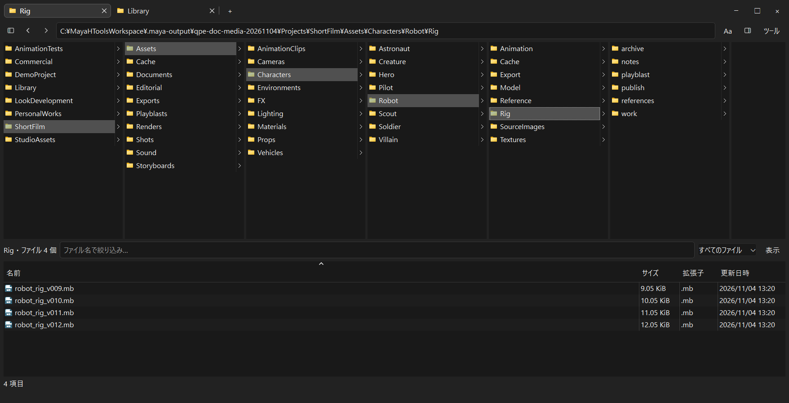

フォルダーとタブ
================

   横1756pxの実画面。撮影用サンプルで、カラムの幅と文字サイズを調整しています。
   画像をクリックすると原寸で拡大できます。

カラムの操作を短く見る
----------------------

トップの :doc:`操作GIF <index>` は、次の流れを示しています。

#. ``Assets → Characters → Robot → Rig`` と順番にクリックして掘り下げます。
#. 途中の列から ``Model``、別キャラクターの ``Hero → Rig`` へ切り替えます。
#. 祖先の ``Shots`` を選び、``Seq010 → Shot010 → scenes`` へ直接たどります。

途中のフォルダーが並んで見えるため、同じ階層まで戻ってから探し直す操作を減らせます。

カラムで移動する
----------------

上段のフォルダーを単クリックすると、右に子フォルダーを表示します。
別のフォルダーを選ぶと後続カラムが更新されます。
各カラムは独立して縦スクロールできます。深い階層では横スクロールも使用します。
移動やタブ切り替えの後は右端のカラムを表示します。手動で左へスクロールした位置は、次の移動やレイアウト変更まで保持します。
ウィンドウが狭いときは、詳細ペインをブラウザーの下へ移して両方を表示します。

戻る／進むボタン、:kbd:`Alt+Left`／:kbd:`Alt+Right`、親への :kbd:`Alt+Up` を使えます。
パス欄へ直接入力する場合は :kbd:`Ctrl+L` で移動します。
Windows形式の ``C:\Projects\scenes`` と、スラッシュ形式の ``C:/Projects/scenes`` を受け付けます。
表示はWindowsの区切りに揃えます。ネットワーク共有は ``\\server\share\folder`` を指定します。

カラム幅と上下の比率
--------------------

**ツール → オプション → 表示** のカラム幅で、ウィンドウ幅への調整とフォルダー名への調整を切り替えます。
境界をドラッグして手動調整もできます。
**ツール → 表示 → ブラウザーのレイアウト** では、カラムを優先／バランス／ファイル一覧を優先を選びます。
上下の境界をドラッグすると手動の比率になり、タブごとに保存します。

タブ
----

タブで別々の場所を保持します。新規は :kbd:`Ctrl+T`、閉じる操作は :kbd:`Ctrl+W`、
直前に閉じたタブの再表示は :kbd:`Ctrl+Shift+T` です。
タブの固定、場所ロック、名前付きタブセットも利用できます。
タブセットの保存・読み込みは **ツール → タブ** にあります。

場所ロックは現在タブの場所を維持するための設定です。
Mayaで別シーンを開いて自動追従する場合は、新しいタブを使います。

左右のサイドバー
----------------

パス欄の左右にあるボタンで、それぞれ表示／非表示を切り替えます。
左はお気に入り、最近使った場所、Windows標準フォルダー、ドライブです。
移動済みのデスクトップやドキュメントもWindowsに登録された場所を使います。
ドライブは名前・レター・使用量・空き／総容量を表示し、現在のドライブを強調します。

右はファイル情報・プレビューとMayaの操作設定です。
狭い画面では詳細表示を全幅へ切り替え、閉じると一覧へ戻ります。

一覧を整える
------------

ファイル一覧の表示から、詳細／サムネイル／拡張情報、列、グループ、子階層を含む表示を変更します。
ファイル名と拡張子の絞り込みは条件ラベルの×で解除できます。

列見出しの上向き矢印は昇順、下向きは降順です。
サイズは大きい順、更新日時は新しい順から始まり、再クリックで反転します。
番号付きの名前は ``file2``、``file10`` の順になります。
一覧の表示方式・列幅・順序は場所ごとに保持します。
