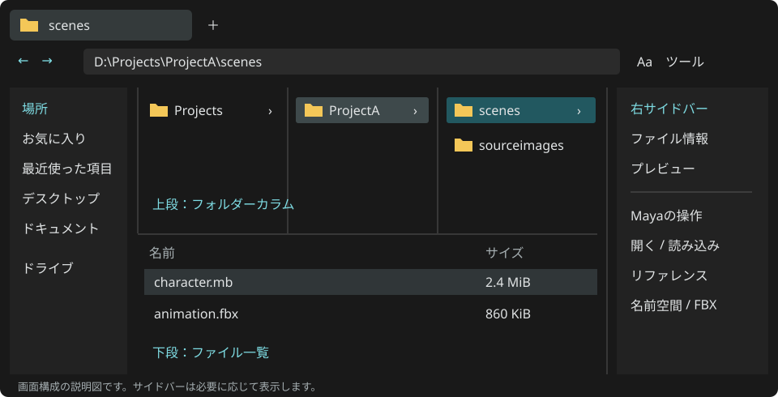

QuickPathExplorer
=================

深いフォルダーをカラムでたどり、WindowsとMayaで同じ操作を使うファイルブラウザーです。
上段でフォルダーを選び、下段でファイルを操作します。左右のサイドバーは必要なときに開けます。

   画面構成の模式図。実際の配色・表示内容はホストと設定によって変わります。

.. list-table::
   :widths: 25 75

   * - Windows版
     - Windows x64向けの ``QuickPathExplorer.exe``。Maya・Pythonの導入は不要です。
   * - Maya版
     - Maya 2022〜2027（Windows）の年別 ``quickPathExplorer.mll``。2022はPython 3で使用します。
   * - 現在の版
     - |release|
   * - 主な機能
     - カラム・タブ・検索、ファイル整理と履歴、MayaのOpen／Save／Import／Reference／FBX

最初に読むページ
----------------

* Windowsで使う、Mayaへ導入する: :doc:`install`
* フォルダーをたどる、タブと一覧を使う: :doc:`browsing`
* ファイルを整理する、検索する: :doc:`files`
* 名前空間やFBXの設定を変える: :doc:`maya`
* 文字サイズ・配色・キーを変える: :doc:`preferences`

.. toctree::
   :maxdepth: 1
   :caption: 使い方

   install
   browsing
   files
   maya
   preferences
   shortcuts

.. toctree::
   :maxdepth: 1
   :caption: 開発・困ったとき

   development
   troubleshooting

このガイドは実装済みのC++／Qt版を説明します。
Windows標準エクスプローラーの置き換え登録や、Mayaファイルの次番号保存は行いません。
