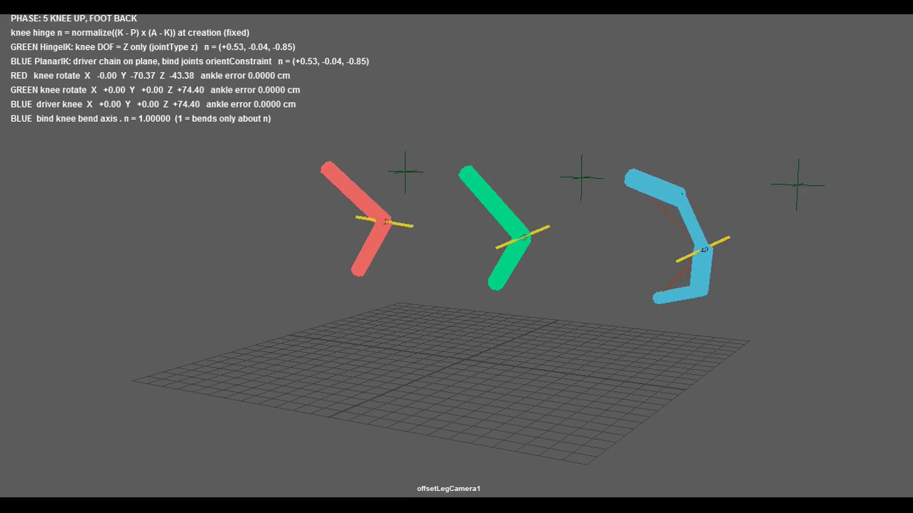

膝を1軸で曲げるIK(ヒンジ軸と自由度)
======================================

``mlrig.setups.HingeIK`` は、膝(中間のjoint)の向きをヒンジ軸に合わせ、自由度(Degrees of Freedom)を
その1軸だけにしてから、Rotate Plane IK(``ikRPsolver``)とポールベクターを作ります。
機械の脚のように付け根・膝・足首が一平面に並ばない脚でも、膝はヒンジ軸だけで曲がります。

.. code-block:: python

   from mlrig.setups import HingeIK

   ik = HingeIK.create("hip_jnt", "knee_jnt", "ankle_jnt", name="legIK")
   cmds.parent(ik.handle, "foot_ctrl")      # 足首の目標
   cmds.parent(ik.pole, "kneePole_ctrl")    # 膝の向き

   # 模型の膝の回転軸が分かっているときは、ワールドの向きで渡す
   ik = HingeIK.create("hip_jnt", "knee_jnt", "ankle_jnt", name="legIK", hinge=(0.5, 0.0, -0.86))

膝が多軸で回る理由
------------------

Rotate Plane IKは、付け根・膝・足首の3点が作る平面を基準に解きます。膝が横にずれていると、
膝の曲がる向きとこの平面が一致せず、IKは膝を複数の軸で回して足首を目標へ届かせます。
膝のjointの向きを自動(``joint -orientJoint``)で付けただけの場合も、曲がる軸がローカルの1軸に揃いません。

Maya標準の ``ikRPsolver`` は、jointの自由度(``jointType`` / ``dofMask``)を守って解きます。
膝の自由度をヒンジ軸の1軸にすると、膝はその軸だけで回り、足りない分は付け根が3軸で回って補います。

引数
----

* ``root`` / ``mid`` / ``end``: 付け根・膝・足首のjoint。``root → mid → end`` が直接の親子であること。
* ``hinge``: ワールドのヒンジ軸(模型の膝の回転軸)。省略すると3点の平面の法線 ``(K - P) × (A - K)`` を使います。
  骨(膝→足首)に直交していなくてかまいません。
* ``axis``: ヒンジ軸にする膝のローカル軸。``"z"`` (既定)または ``"y"``。骨の向きはローカルXです。
* ``poleDistance``: 付け根からポールベクターのlocatorまでの距離。省略するとチェーンの全長です。

処理
----

1. 膝のローカル ``axis`` をヒンジ軸に完全に一致させ、ローカルXを「膝→足首」をヒンジ軸に直交するよう補正した向きにします。
   膝の ``rotate`` ・ ``rotateAxis`` を0にし、向きを ``jointOrient`` へ入れます。足首など膝の子のワールドの位置・向きは変えません。
2. 膝の自由度を ``axis`` の1軸にします(``joint -edit -degreeOfFreedom``)。
3. 3本のjointの ``preferredAngle`` を今の ``rotate`` にします(Skeleton > Set Preferred Angle と同じ)。
   別の値が入っていると、Rotate Plane IKが曲げる平面を決め直し、作った瞬間に姿勢が跳ねます。
4. Rotate Plane IKを作り、作成時のポールベクター(``ikHandle.poleVector``)の延長上にlocatorを置いて
   ``poleVectorConstraint`` します。作った瞬間に姿勢は跳ねません。

ikHandleとlocatorは ``<name>_GRP`` にまとめ、``<name>`` のcontainerが所有します。

制限
----

* 生成時の姿勢を基準にします。bindポーズ(膝を少し曲げた状態)で実行してください。膝の ``jointOrient`` を書き換えます。
* ``root → mid → end`` は直接の親子に限ります。途中に別のjointがある脚は :doc:`planar_ik` を使います。
* 足首の向きは膝からの親子関係のままです。フットコントロールに合わせる場合は、足首へ別に ``orientConstraint`` を付けます。
* 足首の目標が脚の長さより遠いと届きません(Maya標準のIKと同じ)。ストレッチは含みません。

テスト
------

``mlrig/__tests__/test_setup_hinge_ik.py`` (``setups`` スイート)で、膝が横にずれた脚について、
作成前後で付け根・足首の行列と膝の位置が変わらないこと、足首を5通りに動かしても膝のヒンジ軸以外の回転が0で
足首が目標に届くこと、ヒンジ軸の既定値・傾けたヒンジ軸・``axis="y"``・ポールベクターを動かした場合、
引数の検査、生成のUndoを確認します。Maya 2025・2027で確認しています。

検証動画
--------

``tools/demo_offset_leg_ik.py`` は、膝が横にずれた同じ形の脚を3本並べ、足首の目標を同じように動かして録画します。
赤は普通のRotate Plane IK、緑はHingeIK、青は :doc:`planar_ik` です。黄色い線は膝のヒンジ軸(ローカルZ)で、
赤は膝がY・Zの2軸で回るため線が振れます(録画中の最大で約70度)。HUDに式と、毎フレームの膝の回転・足首の到達誤差を表示します。
全384フレームで、緑・青の膝のヒンジ軸以外の回転が0.001度未満、足首の誤差が0.001cm未満であることを独立に計算して判定しています。

`検証動画をGoogle Driveで見る <https://drive.google.com/file/d/1HhmutqWWEFX2RL5ozvd_ovTxpY4tu8DW/view?usp=drivesdk>`_

新規シーンを作るため、作業中のMayaへは送りません。次のコマンドは隔離した使い捨てのMaya 2027 GUIを起動して録画し、
終了後に閉じます。結果は ``.maya-output/verification/<実行ID>/`` (``verification.mp4`` ・ ``result.json`` ・
``offset-leg-ik.ma``)に保存し、最新のフォルダーを ``latest-offset-leg-ik.json`` に記録します。

.. code-block:: powershell

   & 'C:/Program Files/Autodesk/Maya2027/bin/mayapy.exe' tools/demo_offset_leg_ik.py --launch
